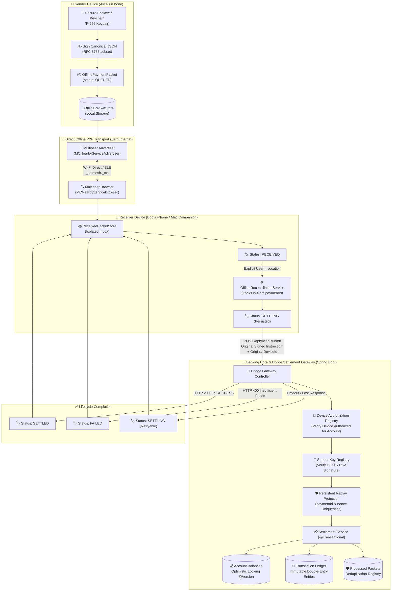
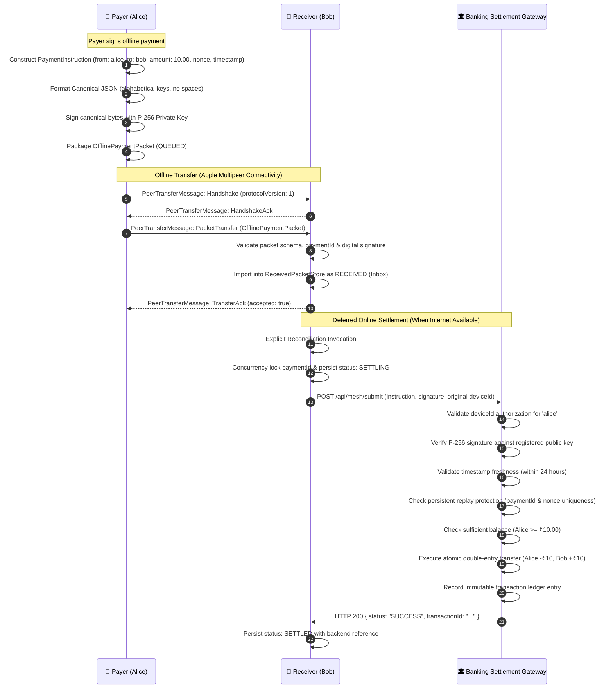
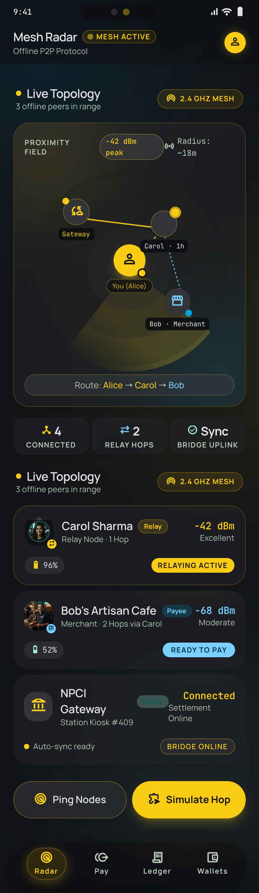
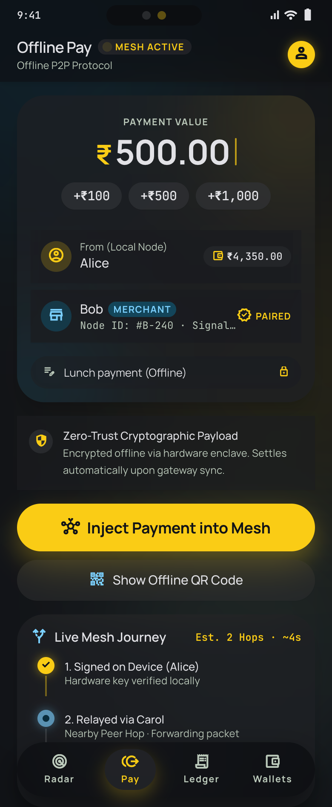
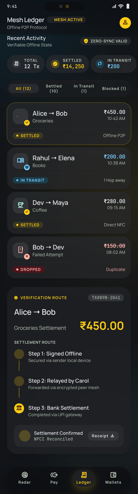
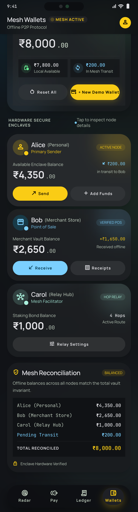

<div align="center">

# 🌐 UPI Offline Mesh Simulation Environment

### *Decentralized, Peer-to-Peer Offline Payment Routing with Cryptographic Sender Authentication, Direct Apple Multipeer Wireless Transport, Persistent Replay Protection & Double-Entry Ledger Reconciliation*

[](https://openjdk.org/)
[](https://spring.io/projects/spring-boot)
[](https://github.com/Jarjis-Alam/upimesh)
[](https://github.com/Jarjis-Alam/upimesh)
[](https://github.com/Jarjis-Alam/upimesh)
[](https://github.com/Jarjis-Alam/upimesh)
[](https://github.com/Jarjis-Alam/upimesh)
[](https://opensource.org/licenses/Apache-2.0)

<br/>

[About](#-about-the-project) •
[Key Capabilities](#-key-capabilities) •
[System Architecture](#-system-architecture) •
[Cryptographic Pipeline](#-cryptographic-security-pipeline) •
[Direct P2P Wireless Transport](#-direct-offline-peer-to-peer-transport) •
[Native iOS App](#-native-ios-app-liquid-mesh-upi) •
[macOS Test Companion](#-native-macos-test-companion) •
[Quickstart](#-quickstart-guide) •
[API Reference](#-api-reference) •
[Reconciliation Engine](#-mathematical-reconciliation-engine) •
[Test Suite](#-test-suite--verification) •
[Roadmap](#-development-stages-roadmap)

---

</div>

## 📖 About the Project

### The Connectivity Problem in Digital Payments
The Unified Payments Interface (UPI) processes billions of transactions monthly, transforming digital commerce. However, its fundamental assumption is **continuous, end-to-end cellular or internet connectivity** between mobile clients, telecom infrastructure, banking switches, and the central NPCI network.

When connectivity drops, digital transactions fail entirely. Real-world scenarios include:
- **Disaster Zones & Outages**: Earthquakes, cyclones, or power grid failures that sever telecom towers.
- **Underground & Transit**: Underground metro stations, basements, highway tunnels, and remote railway routes.
- **High-Density Congestion**: Music festivals, stadiums, or demonstrations where cellular towers face bandwidth exhaustion.
- **Remote & Rural Areas**: Rural villages and hilly terrains lacking reliable cellular coverage.

---

### The Solution: Multi-Hop Store-and-Forward Mesh
**UPI Offline Mesh** introduces an opportunistic, multi-hop peer-to-peer architecture for offline payments. Rather than requiring direct cellular access to banking servers at the moment of payment:

1. **Local Offline Signing**: The payer creates a cryptographically signed payment instruction directly on their device using hardware-backed asymmetric keypairs (**P-256 ECDSA / RSASSA-PSS SHA-256**).
2. **Deterministic Canonicalization**: The instruction is serialized to canonical JSON (RFC 8785 subset) ensuring byte-for-byte deterministic signature verification across iOS (Swift) and banking backend (Java).
3. **Direct Ad-Hoc Wireless Transport**: The signed packet is exchanged between physical devices over Apple's **Multipeer Connectivity framework** (Wi-Fi Direct / Bluetooth Low Energy) with zero router or cellular connectivity.
4. **Isolated Receiver Lifecycle**: The receiver stores the packet in a dedicated inbox (`RECEIVED`) without mixing it into outgoing queues or prematurely assuming balance settlement.
5. **Opportunistic Bridge Reconciliation**: When either party or an authorized relay encounters internet connectivity, an explicit reconciliation service submits the original signed packet to the banking core.
6. **Authoritative Double-Entry Settlement**: The backend validates device authorization, verifies digital signatures, defends against nonces and replays, and commits an atomic double-entry balance adjustment.

---

### 🔍 How It Compares

| Feature | Standard Online UPI | UPI Lite X (NFC) | **UPI Offline Mesh** |
|---|:---:|:---:|:---:|
| **Internet Required at Payment Time** | ✅ Mandatory (Both parties) | ❌ Offline Tap | ❌ **100% Offline (Zero Internet)** |
| **Direct Proximity to Merchant Only** | N/A | ✅ Mandatory (1-to-1 Tap) | ❌ **Multi-hop peer forwarding** |
| **Relay Capability** | ❌ No | ❌ No | ✅ **Peer-to-peer opportunistic relays** |
| **Intermediate Relay Privacy** | N/A | N/A | ✅ **Zero-Knowledge (Opaque Ciphertext / Signed Envelopes)** |
| **Replay & Double-Spend Defense** | Central switch validation | Device wallet counters | ✅ **Compound DB constraints, Nonce Tables & Hash Claims** |
| **Ledger Reconciliation** | Immediate synchronous | Delayed sync | ✅ **Decoupled audit with mathematical proof & lifecycle states** |

---

## 📌 Executive Summary

**UPI Offline Mesh** is a complete, production-grade offline payment simulation and prototype stack. It integrates:
- A **Spring Boot 4.2** backend providing atomic double-entry ledger transactions, persistent device authorization registries, replay protections, and an automated continuous audit reconciliation engine.
- A **Native iOS SwiftUI Client (Liquid Mesh UPI)** featuring device-side key generation (Keychain / Secure Enclave), canonical instruction signing, local packet queues, Apple Multipeer Connectivity direct transport, and received-packet lifecycle management.
- A **Native macOS Test Companion** enabling zero-infrastructure cross-device physical testing between MacBooks and iPhones.
- **211 Automated Tests** (144 Java + 67 Swift) with 100% pass rates across cryptographic verification, peer transport protocols, and reconciliation edge cases.

---

## 🚀 Key Capabilities

- **🔐 Device-Bound Cryptographic Signatures**: Senders sign payments locally using **P-256 ECDSA (SHA-256)** or **RSASSA-PSS**, bound to a persistently registered device identity in the bank's core registry.
- **📜 Cross-Language Deterministic Canonicalization**: Custom canonical JSON serializers in Swift and Java enforce strict key sorting, unescaped slashes, and floating-point precision equivalence, ensuring identical byte digests across platforms.
- **📡 Direct Wireless P2P Transport (Multipeer Connectivity)**: Physical iPhones and Mac companion nodes discover each other and transfer payment packets offline via Wi-Fi Direct and Bluetooth Low Energy (`_upimesh._tcp`).
- **🛡️ Strict Receiver State Machine**: Received packets are stored in an isolated inbox with deterministic lifecycle states:
  - `RECEIVED` — Awaiting settlement submission.
  - `SETTLING` — Actively in-flight to backend; persistent to survive app restarts.
  - `SETTLED` — Confirmed by authoritative banking response.
  - `FAILED` — Definitive terminal rejection (e.g., insufficient funds).
- **⚡ Persistent Replay & Nonce Defense**: Multi-layered defense coupling canonical SHA-256 hash deduplication, global `paymentId` uniqueness, and persistent `(fromAccount, nonce)` uniqueness constraints.
- **⚖️ Double-Entry Ledger & Audit Engine**: Atomic ledger recording with optimistic concurrency locking (`@Version`); decoupled read-only audit engine checking $\sum \text{Debits} \equiv \sum \text{Credits}$ and $E(i) = B_0(i) + \Delta(i)$.
- **🔄 Concurrency-Guarded Reconciliation Client**: `OfflineReconciliationService` on iOS submits received packets with the original signer device ID, locks in-flight payment IDs against duplicate requests, and treats ambiguous network failures as retryable rather than falsely settled.

---

## 🏛️ System Architecture



---

## 🔒 Cryptographic Security Pipeline



---

## 📡 Direct Offline Peer-to-Peer Transport

In Stages 6.3B & 6.3C, UPI Offline Mesh introduced native offline wireless transmission using Apple's **Multipeer Connectivity framework**:

- **Zero Network Infrastructure**: Operates over peer-to-peer Wi-Fi and Bluetooth Low Energy. Requires no router, mobile data, or external hotspot.
- **Service Type**: Registered under Bonjour service type `_upimesh._tcp`.
- **Peer Role Discovery**:
  - `MCNearbyServiceAdvertiser`: Broadcasts availability with device identity metadata.
  - `MCNearbyServiceBrowser`: Discovers nearby peer nodes in real-time.
- **Strict Protocol Handshake**:
  ```swift
  public enum PeerTransferMessage: Codable {
      case handshake(HandshakePayload)
      case packetTransfer(PacketTransferPayload)
      case transferAck(TransferAckPayload)
  }
  ```
- **Integrity Enforcement**: Upon receipt, the receiver immediately validates packet structure, schema version (`1`), and mathematical digital signature.
- **Inbox Isolation**: Received packets are stored in `ReceivedPacketStore`, completely isolated from the sender's `OfflinePacketStore`. A received packet is **never** considered settled upon arrival.

---

## 📱 Native iOS App (Liquid Mesh UPI)

Located in [`ios/UPIMesh/`](ios/UPIMesh/), engineered with SwiftUI and the **Liquid Mesh UPI** design system.

### 📸 Mobile Interface Gallery

| 📡 Mesh Radar | 💳 Offline Pay |
|:---:|:---:|
|  |  |
| **P2P Radar & Device Discovery**<br/>Simulated mesh proximity, dynamic relay peer detection, RSSI signal visualization, and bridge gateway tracking. | **Offline Signing & Peer Transfer**<br/>Create cryptographically signed offline packets, manage queued payments, select nearby discovered peers, and transmit directly over Multipeer Connectivity. |
| **📖 Mesh Ledger** | **💼 Mesh Wallets** |
|  |  |
| **Audit Journal & Verification**<br/>Chronological ledger entries, cryptographic proof badges, SHA-256 idempotency claims, and signature verification logs. | **Device Registration & Wallets**<br/>Real-time account balance synchronization, device identity management (P-256 Keychain pair), and one-tap bank device authorization. |

### 💎 Key iOS Architecture Highlights
- **Liquid Mesh Design System**: Frosted glassmorphism, dynamic glowing gradient orbs, tactile haptics, and custom bottom navigation.
- **Hardware Cryptography**: `DeviceIdentityManager.swift` manages Secure Enclave / Keychain P-256 keypairs with deterministic DER and raw public key export.
- **Offline Packet Engine**:
  - `PaymentInstruction.swift`: Value-type instruction with RFC 8785 canonical JSON formatting.
  - `OfflinePacketStore.swift`: Thread-safe, disk-persisted queue for locally created payment packets.
  - `ReceivedPacketStore.swift`: Thread-safe, disk-persisted inbox for incoming payments with atomic lifecycle states (`RECEIVED`, `SETTLING`, `SETTLED`, `FAILED`).
  - `OfflineReconciliationService.swift`: Explicit settlement submission service forwarding original signer identity and managing safe recovery states.

---

## 💻 Native macOS Test Companion

Located in [`macos/UPIMeshCompanion/`](macos/UPIMeshCompanion/), the macOS Companion is a standalone native macOS application designed as a physical companion node:

- **Purpose**: Enables true physical multi-device testing without requiring two physical iPhones. Run the companion on your MacBook and UPIMesh on your iPhone to test bidirectional peer discovery and offline packet transfer.
- **Zero-Dependency Standalone Build**: Includes a dedicated shell build script (`build_macos_companion.sh`) using `swiftc` that produces a self-contained `.app` bundle.
- **Features**:
  - Real-time peer discovery radar (discovering iPhones over Wi-Fi Direct / BLE).
  - Packet inspector displaying raw canonical JSON and cryptographic signatures.
  - Dedicated received-packet store with lifecycle status tracking.

---

## 🛠️ Quickstart Guide

### Prerequisites
- **JDK**: Java 17 or higher
- **Maven**: Maven Wrapper (`./mvnw`) included
- **macOS**: macOS 14.0+ (for running iOS Simulator or macOS Companion)
- **Xcode**: Xcode 16+ (optional, command-line Swift scripts included)

---

### 1. Build & Run the Backend
```bash
# Clone the repository
git clone https://github.com/Jarjis-Alam/upimesh.git
cd upimesh

# Compile backend
./mvnw clean compile

# Run all 135 Java backend tests
./mvnw test

# Start the Spring Boot server
./mvnw spring-boot:run
```

Once running:
- **API Base URL**: `http://localhost:8080`
- **H2 Web Console**: [http://localhost:8080/h2-console](http://localhost:8080/h2-console)
  - **JDBC URL**: `jdbc:h2:file:./data/upimesh`
  - **User**: `sa`
  - **Password**: *(leave blank)*

---

### 2. Run the Native Swift Test Suite (38 Tests)
Run all 38 iOS and macOS companion tests directly from the terminal without Xcode:
```bash
./run_ios_tests.sh
```

---

### 3. Build & Run the macOS Companion App
```bash
# Build the native macOS companion app
./build_macos_companion.sh

# Launch the companion app
open macos/UPIMeshCompanion/build/UPIMeshCompanion.app
```

---

### 4. Run the Native iOS Mobile App
```bash
open ios/UPIMesh/UPIMesh.xcodeproj
```
1. Open the project in Xcode.
2. Select any **iOS Simulator** (e.g., iPhone 16) or a connected physical iPhone.
3. Build and run (**⌘R**).

---

## 📡 API Reference

### 1. Query Accounts
```bash
GET /api/accounts
```
**Response (`200 OK`):**
```json
[
  { "id": "alice", "balance": 4970.00, "version": 2 },
  { "id": "bob", "balance": 1030.00, "version": 2 },
  { "id": "carol", "balance": 2000.00, "version": 0 }
]
```

---

### 2. Register Device Public Key & Account Authorization
```bash
POST /api/devices/register
Content-Type: application/json

{
  "deviceId": "dev-alice-iphone-16",
  "accountId": "alice",
  "publicKey": "MFkwEwYHKoZIzj0CAQYIKoZIzj0DAQcDQgAE...",
  "algorithm": "SHA256withECDSA"
}
```
**Response (`200 OK`):**
```json
{
  "success": true,
  "deviceId": "dev-alice-iphone-16",
  "accountId": "alice",
  "authorizedAt": "2026-10-13T10:15:00Z"
}
```

---

### 3. Submit Device-Signed Offline Payment
Submits an offline-generated payment packet for authoritative settlement.
```bash
POST /api/mesh/submit
Content-Type: application/json

{
  "deviceId": "dev-alice-iphone-16",
  "instruction": {
    "paymentId": "5c11d041-e945-4299-bb6e-827eb0c8a3cf",
    "fromAccount": "alice",
    "toAccount": "bob",
    "amount": 10.00,
    "nonce": "a7b3c2d1e0f9482b",
    "timestamp": 1791898800000
  },
  "signature": "MEQCIA..."
}
```
**Response (`200 OK`):**
```json
{
  "status": "SUCCESS",
  "message": "Device-signed payment settled successfully",
  "transactionId": "e93ab630-f921-4f40-8774-681b490f23be",
  "fromAccount": "alice",
  "toAccount": "bob",
  "amount": 10.00,
  "settledAt": "2026-10-13T10:15:30Z"
}
```

---

### 4. Query Transaction Ledger
```bash
GET /api/transactions
```
**Response (`200 OK`):**
```json
[
  {
    "id": "e93ab630-f921-4f40-8774-681b490f23be",
    "fromAccount": "alice",
    "toAccount": "bob",
    "amount": 10.00,
    "status": "SETTLED",
    "timestamp": "2026-10-13T10:15:30Z"
  }
]
```

---

### 5. Run Continuous Ledger Reconciliation Audit
```bash
GET /api/reconciliation
```
**Response (`200 OK`):**
```json
{
  "isReconciled": true,
  "isLedgerBalanced": true,
  "isBalancesReconciled": true,
  "structuralStatus": "BALANCED",
  "balanceStatus": "RECONCILED",
  "totalTransactionsChecked": 2,
  "totalLedgerDebits": 30.00,
  "totalLedgerCredits": 30.00,
  "systemZeroSumMaintained": true,
  "discrepancies": [],
  "unverifiableAccounts": []
}
```

---

## ⚖️ Mathematical Reconciliation Engine

Reconciliation strictly decouples **structural journal invariants** from **individual account balance verification**:

### 1. Structural Ledger Check
$$\sum \text{Debits} \equiv \sum \text{Credits}$$
- Validates double-entry symmetry across the entire transaction journal.
- A balanced ledger proves internal consistency, but does not prove individual accounts were free of external tampering.

### 2. Account Balance Verification
For each account $i$ with authoritative opening baseline $B_0(i)$:
$$E(i) = B_0(i) + \text{Credits}(i) - \text{Debits}(i)$$
$$\Delta(i) = A(i) - E(i)$$
- **`RECONCILED`**: $\Delta(i) = 0$
- **`DISCREPANCY`**: $\Delta(i) \neq 0$ (flagged without silent mutations)
- **`UNVERIFIABLE`**: If $B_0(i)$ is absent, the account is explicitly audited as `UNVERIFIABLE`.

---

## 🧪 Test Suite & Verification

The project enforces strict automated test verification across both backend and native clients:

```
[INFO] Results:
[INFO] Tests run: 144, Failures: 0, Errors: 0, Skipped: 0
[INFO] BUILD SUCCESS

==================================================
All 67 offline tests PASSED!
==================================================
```

### Comprehensive Test Matrix (211 Passing Tests)

| Language / Framework | Suite | Tests | Verification Area |
|---|---|:---:|---|
| **Java (Spring Boot)** | `OperationalHardeningTest` | 13 | Restart persistence, DataSeeder non-overwrite, sanitized API errors |
| | `BackendIntegrationLayerTest` | 15 | Bridge public key export, external packet ingestion, atomic settlement |
| | `DeviceSignedPaymentSubmissionTest` | 8 | Public key verification, device authorization, balance & replay defense |
| | `SecureDeviceAuthorizationTest` | 9 | Timing-safe admin token validation, environment secret resolution, unauthorized & duplicate guards |
| | `PersistentDeviceRegistryTest` | 6 | Device registration persistence, key updates, account binding |
| | `CrossLanguageCanonicalizationTest` | 1 | RFC 8785 byte-for-byte serialization match between Java & Swift |
| | `LedgerReconciliationTest` | 9 | Double-entry invariants, circular transfers, tampering detection |
| | `SenderAuthenticationTest` | 9 | RSASSA-PSS SHA-256 signature verification, canonical byte serialization |
| | `PersistentReplayProtectionTest` | 7 | DB compound `(fromAccount, nonce)` uniqueness, re-encryption defense |
| | `PersistentIdempotencyTest` | 7 | Service re-instantiation idempotency, SHA-256 deduplication, concurrency |
| | `TransactionLedgerIntegrationTest` | 6 | Atomic ledger recording, balance adjustments, chronological indexing |
| | `BridgeIngestionServiceTest` | 10 | Hybrid decryption, payload validation, clock skew & expiration |
| | `MeshSimulatorServiceTest` | 5 | Multi-hop gossip rounds, loop prevention, TTL expiration |
| | `EndToEndMeshPaymentTest` | 5 | End-to-end controller & simulation integration |
| | `CryptoServiceTest` | 9 | RSA-OAEP key wrapping, AES-256-GCM ciphering, signature schemes |
| | `MeshPacketTest` & `PaymentInstructionTest` | 15 | Immutability, canonical representation, validation invariants |
| | `IdempotencyServiceTest` | 5 | Atomic in-memory claims, state lifecycle transitions |
| | `UpimeshApplicationTests` | 1 | Spring Boot ApplicationContext bootstrapping |
| **Swift (iOS / macOS)** | `OfflinePaymentPacketTests` | 9 | Packet creation, canonicalization, P-256 signing, deduplication |
| | `PeerTransportTests` | 22 | Multipeer handshake, packet serialization, tamper detection, inbox lifecycle, diagnostic ping/pong & latency |
| | `ReconciliationServiceTests` | 14 | Settlement transitions, terminal rejections, timeout recovery, idempotency & retry handling |
| | `MeshLedgerViewModelTests` | 7 | Live backend transaction sync, offline local counts, connection handling, preview isolation |
| | `MacCompanionTests` | 15 | macOS packet decoding, deduplication, tampering rejection, lifecycle states, diagnostic ping responder & latency |
| **Total** | **23 Test Suites** | **211** | **Zero Failures, Zero Flakiness** |

---

## 🗺️ Development Stages Roadmap

- [x] **Stage 1–4**: Spring Boot cryptographic mesh simulation, hybrid encryption, gossip routing, double-entry ledger & continuous audit engine.
- [x] **Stage 5**: Native device-signed payments: Secure Enclave P-256 key generation, device authorization registry, and `/api/mesh/submit` settlement.
- [x] **Stage 6.1**: Local offline payment packet model (`OfflinePaymentPacket`), canonical JSON serialization, and persistent `OfflinePacketStore`.
- [x] **Stage 6.2**: iOS UI integration for offline packet creation, queue management, and balance pre-validation.
- [x] **Stage 6.3A & 6.3B**: Direct offline wireless transport via Apple's **Multipeer Connectivity framework** (Wi-Fi Direct / BLE) with isolated receiver inbox.
- [x] **Stage 6.3C**: Native macOS Test Companion app for physical cross-device iPhone ↔ MacBook offline transfers.
- [x] **Stage 6.4A**: Reconciliation architecture inspection and backend idempotency audit.
- [x] **Stage 6.4B.1**: Persistent received-packet lifecycle state machine (`RECEIVED`, `SETTLING`, `SETTLED`, `FAILED`).
- [x] **Stage 6.4B.2**: Focused iOS client `OfflineReconciliationService` with concurrency locks, original signer identity forwarding, and safe retryable recovery.
- [x] **Stage 6.4B.3**: Received Packets inbox UI with explicit user-controlled reconciliation actions and granular status feedback.
- [x] **Stage 6.4B.4**: Connect iOS Mesh Ledger to live backend transactions and dynamic balances with offline in-transit counts.
- [x] **Stage 6.4B.5 & 6.4B.6**: Mac Companion Bridge registration client (`POST /api/keys/register`) and registration UI.
- [x] **Stage 6.4B.7**: Secure development device authorization via environment administrator pairing token (`POST /api/devices/authorize`).
- [x] **Safe Peer Connectivity Test**: Non-financial peer diagnostic Ping/Pong protocol with round-trip latency measurement over Multipeer Connectivity.

---

## 🔒 Security & Prototype Limitations

> [!WARNING]
> This repository is an educational prototype and architectural simulation of offline UPI concepts. It does not claim production-grade compliance with NPCI / RBI banking standards.

1. **Hardware Root of Trust**: In production offline UPI, private keys must reside in hardware secure elements (e.g., SIM Card SE, Android StrongBox Keymaster, Apple Secure Enclave with user presence biometric requirements).
2. **Offline Double-Spending**: True offline transactions carry inherent credit/double-spend risk until reconciled. In production, this requires hardware-enforced monotonic offline balance counters (such as in UPI Lite X).
3. **PKI Infrastructure**: Device registration in this prototype uses an open registration API. Production deployment requires X.509 certificate chains signed by accredited banking certificate authorities (CA).

---

## 📄 License

This project is licensed under the [Apache License 2.0](LICENSE).
