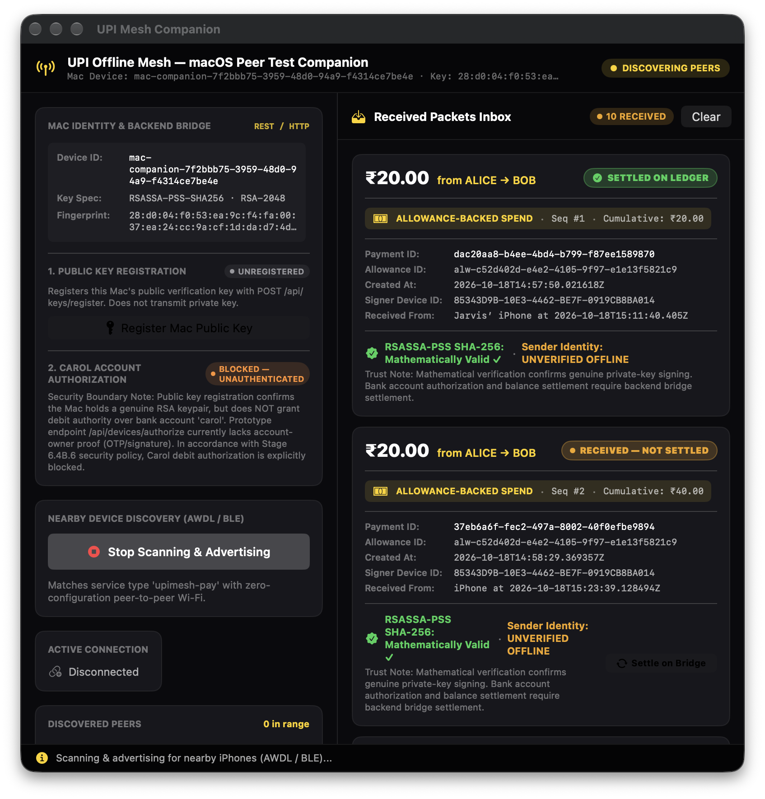
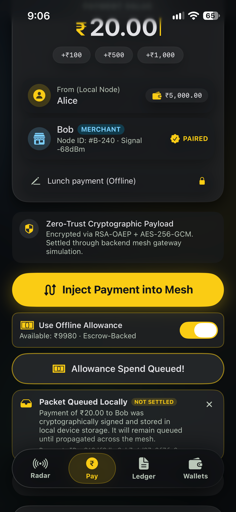
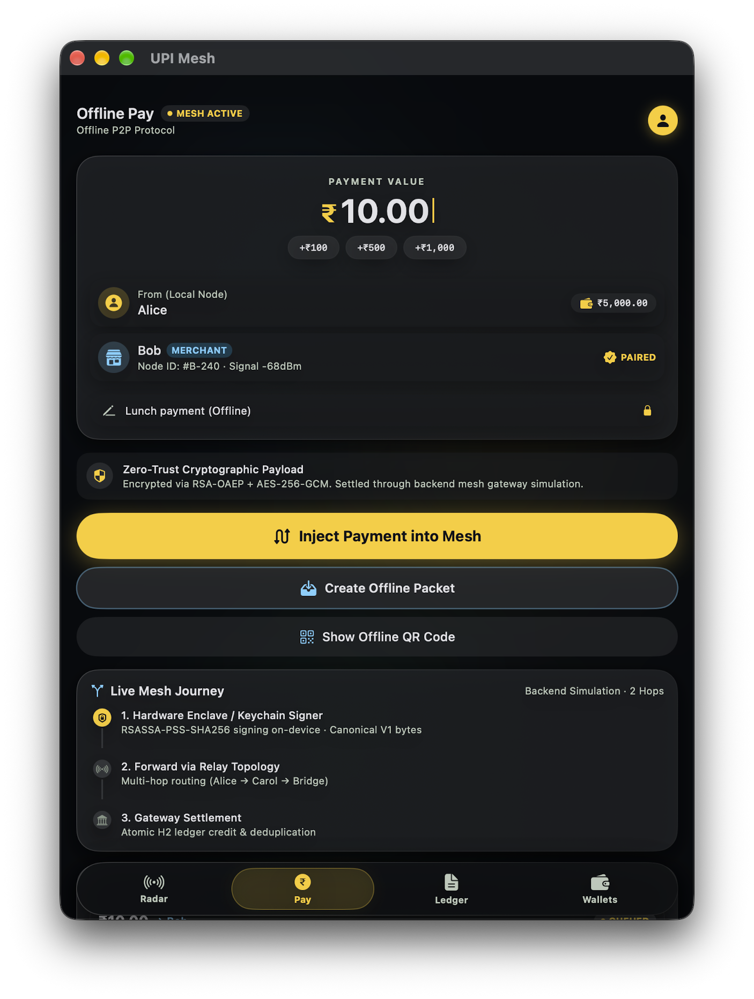

<div align="center">


# 🌐 MeshPay / UPI Offline Mesh

### *Decentralized, Peer-to-Peer Offline Payment Routing with Dual Cryptographic Signatures, Direct Apple Wireless Multipeer Transport, Bank-Issued Allowance Vouchers, Persistent Replay Idempotency & Mathematical Double-Entry Ledger Reconciliation*

[](https://openjdk.org/)
[](https://spring.io/projects/spring-boot)
[](https://github.com/Jarjis-Alam/upimesh)
[](https://github.com/Jarjis-Alam/upimesh)
[](https://github.com/Jarjis-Alam/upimesh)
[](https://github.com/Jarjis-Alam/upimesh)
[](https://github.com/Jarjis-Alam/upimesh)
[](https://opensource.org/licenses/Apache-2.0)

<br/>

> [!IMPORTANT]
> **RESEARCH & EDUCATIONAL PROTOTYPE CLASSIFICATION**
> MeshPay / UPI Offline Mesh is an experimental academic and educational prototype exploring store-and-forward offline payment routing, cryptographic allowance vouchers, and Apple Multipeer wireless transport. It is **not affiliated with, endorsed by, or connected to the National Payments Corporation of India (NPCI), the Reserve Bank of India (RBI), or live production UPI banking rails**. All account identifiers (`alice`, `bob`, `carol`), cryptographic keys, and ledger transactions in this repository are synthetic, isolated testbed fixtures.

<br/>

[About](#-about-the-project) •
[Physical Milestone](#-physical-device-milestone-verified-100-payment) •
[Core Capabilities](#-core-capabilities) •
[System Architecture](#-system-architecture) •
[Cryptographic Pipeline](#-dual-signature-cryptographic-pipeline) •
[Direct P2P Transport](#-direct-offline-peer-to-peer-transport) •
[iOS & macOS Apps](#-native-applications-macos-ipados--ios) •
[Quickstart](#-quickstart-guide) •
[API Reference](#-api-reference) •
[Reconciliation Engine](#-mathematical-reconciliation-engine) •
[Test Suite](#-test-suite--verification-399-passing-tests) •
[Security Model & Boundaries](#-security-model--threat-boundaries) •
[Documentation Index](#-documentation-index)

---

</div>

## 📖 About the Project

### The Connectivity Bottleneck in Digital Payments
The Unified Payments Interface (UPI) handles billions of transactions monthly, powering financial inclusion. However, its foundational premise is **continuous, synchronous cellular or internet connectivity** linking mobile clients, telecom infrastructure, banking switches, and the central NPCI network.

When telecom links sever, digital payments cease entirely. Critical real-world scenarios include:
- **Disaster Zones & Power Grid Outages**: Severe weather, earthquakes, or substation blackouts severing cell towers.
- **Underground Transit & Remote Topography**: Subways, basements, deep tunnels, and remote mountainous transit lacking radio penetration.
- **High-Density Congestion**: Music festivals, crowded bazaars, and stadiums where cell towers suffer radio bandwidth exhaustion.
- **Rural & Underserved Regions**: Connectivity-sparse corridors where merchant-customer proximity exists without continuous cloud backhaul.

---

### The Architecture: Allowance-Backed P2P Mesh with Authoritative Escrow
**MeshPay / UPI Offline Mesh** resolves this bottleneck through a peer-to-peer, store-and-forward architecture built on **bank-issued cryptographic allowances** and **direct device-to-device wireless transport**:

1. **Pre-Authorized Bank Allowance**: While online, the payer reserves funds from their balance into bank escrow (`system-escrow`). The banking core issues a digitally signed `OfflineAllowance` voucher authenticated with **2048-bit RSA-PSS (SHA-256)**.
2. **Dual-Signature Scheme**: Offline payments require two distinct signatures:
   - **Bank Authority Voucher Signature**: Proves the existence of genuine reserved escrow funds.
   - **Payer Device Signature**: Proves authentic instruction consent signed on-device via **2048-bit RSASSA-PSS** (with NIST P-256 Secure Enclave architecture designed for hardware attestation).
     *Note: Offline mathematical verification proves key possession, but authentic binding of a public key to an account identity requires authoritative verification against the banking registry during bridge settlement.*
3. **Zero-Internet Wireless Exchange**: The payer transmits the signed payment packet to the merchant over Apple's **Multipeer Connectivity framework** (Wi-Fi Direct / Apple Wireless Direct Link / Bluetooth Low Energy) with zero cellular, Wi-Fi router, or internet access.
4. **Deterministic Canonicalization (RFC 8785 subset)**: Custom canonical JSON serialization in Swift and Java guarantees byte-for-byte deterministic signature verification across iOS and Spring Boot.
5. **Isolated Receiver Inbox & Provisional Status**: The merchant companion records the payment in an isolated storage inbox (`RECEIVED — NOT SETTLED`) without inflating balances. An offline payment remains strictly **provisional** until bridge settlement.
6. **Delayed Bridge Settlement & Persistent Idempotency**: When a node reaches connectivity, it submits the spend record to the bank bridge. The settlement engine executes an atomic double-entry transfer from escrow to the merchant, enforces strict sequence monotonic timestamps, audits for sequence forks, and enforces persistent replay idempotency.
7. **Mathematical Double-Entry Reconciliation**: A decoupled audit engine mathematically verifies total double-entry conservation ($\sum \text{Debits} \equiv \sum \text{Credits}$) and reconciles all account closing balances against opening baselines.

---

## 🏆 Physical Device Milestone: Verified ₹100 Payment

> [!NOTE]
> **Sanitized Testbed Demonstration Data**
> All financial amounts, account handles (`alice`, `bob`, `carol`), device identifiers, and payment UUIDs shown below were generated inside an isolated, non-production testbed environment backed by a local H2 database (`./data/upimesh.mv.db`). No real-world currency, personal identifiable information (PII), or production banking rails were used.

The architecture has been proven end-to-end on **physical testbed hardware** (Physical iPhone 14 + MacBook Pro merchant node + Spring Boot backend on a persistent H2 database):

- **Payment ID**: `dd3bd00c-646a-4d8d-9fb2-828505c3e9b4`
- **Payer**: Alice (`alice`) $\rightarrow$ **Merchant**: Bob (`bob`)
- **Amount**: **₹100.00 INR** (Sequence 1)
- **Settlement Status**: `SETTLED` (Escrow debited ₹100; Bob credited ₹100)
- **Payer Post-Payment Balance**: ₹4,870.00 (from ₹5,000.00 opening balance; ₹100 settled, ₹30 prior online transfer)
- **Recipient Post-Payment Balance**: ₹1,130.00 (from ₹1,000.00 opening balance; ₹100 credited, ₹30 prior online transfer)
- **Escrow Balance**: ₹0.00 (fully settled and cleared)
- **Double-Entry Ledger Status**: **BALANCED** ($\sum \text{Debits} = \text{₹430.00} \equiv \sum \text{Credits} = \text{₹430.00}$)
- **Replay Protection**: Verified that replaying the identical payment instruction returns **HTTP 200 OK** without crediting the merchant a second time.

Detailed hardware verification data is preserved in [`docs/reports/hardware_verification_report_100_inr.md`](docs/reports/hardware_verification_report_100_inr.md).

---

## 🚀 Core Capabilities

- **🔐 Dual Cryptographic Authentications**: Bank authority voucher signing with **2048-bit RSA-PSS**; payer client signing with **2048-bit RSASSA-PSS** stored in the iOS software Keychain (`kSecAttrAccessibleAfterFirstUnlockThisDeviceOnly`), with NIST P-256 Secure Enclave architecture designed for hardware attestation.
- **🛡️ Authenticated Key Storage at Rest**: The Bank Authority master private key is protected at rest with **AES-256-GCM** using externally provisioned secrets (`UPI_MESH_KEY_ENCRYPTION_KEY`).
- **🔒 Scoped Administrative Access Control**: Fail-closed token authentication (`UPI_MESH_ADMIN_TOKEN` / `X-Admin-Token` header) on reconciliation, sensitive audits, and device authorization.
- **📡 Direct Wireless P2P Transport (Multipeer Connectivity)**: Physical iPhones and Mac companion nodes discover peers and transfer payment packets offline over peer-to-peer Wi-Fi and Bluetooth (`_upimesh-pay._tcp`).
- **⚡ Step 2 Replay Protection & Idempotency**: Persistent database uniqueness checks intercept replayed payment IDs before balance modifications or allowance alterations, returning idempotent HTTP 200 responses.
- **⚖️ Double-Entry Ledger & Continuous Audit Engine**: Optimistic concurrency locking (`@Version`); read-only mathematical reconciliation audit checking $\sum \text{Debits} \equiv \sum \text{Credits}$ and $E(i) = B_0(i) + \Delta(i)$.
- **🚨 Sequence Fork & Fraud Detection**: Conflicting spend payments claiming the same sequence number trigger automatic `SEQUENCE_FORK_CONFLICT` security events and immediately revoke the parent allowance.
- **📱 Native Apple Clients**: Full SwiftUI iOS mobile application (**Liquid Mesh UPI**) and native code-signed macOS Companion application.

---

## 🏛️ System Architecture


---

## 🔒 Dual-Signature Cryptographic Pipeline

```mermaid
sequenceDiagram
    autonumber
    participant Alice as 📱 Payer Alice (iPhone 14)
    participant Bank as 🏛️ Bank Core Gateway
    participant Bob as 💻 Merchant Bob (Mac Companion)

    Note over Alice,Bank: Phase 1: Online Allowance Issuance
    Alice->>Bank: POST /api/allowance/issue (accountId: alice, amount: ₹100, deviceId)
    Bank->>Bank: Debit Alice ₹100.00 ➔ Credit system-escrow ₹100.00
    Bank->>Bank: Generate Canonical Voucher Bytes
    Bank->>Bank: Sign Voucher with Bank Authority Private Key (RSA-PSS SHA-256)
    Bank-->>Alice: OfflineAllowanceVoucherResponse (allowanceId, voucherSignature, bankPublicKey)
    Alice->>Alice: Persist active voucher in OfflineAllowanceManager

    Note over Alice,Bob: Phase 2: Disconnected Offline Payment (AWDL / Multipeer)
    Alice->>Alice: Construct Spend Record (paymentId, seq: 1, amount: ₹100, cumulative: ₹100)
    Alice->>Alice: Sign Canonical Spend Bytes with Payer Private Key (2048-bit RSASSA-PSS)
    Alice->>Bob: PeerTransferMessage: Handshake (protocolVersion: 1)
    Bob-->>Alice: PeerTransferMessage: HandshakeAck
    Alice->>Bob: PeerTransferMessage: PacketTransfer (Voucher + SpendRecord)
    Bob->>Bob: Verify Voucher Signature using Pinned Bank Public Key
    Bob->>Bob: Verify Payer Digital Signature (Mathematical only; identity unauthenticated until bridge settlement)
    Bob->>Bob: Store in Isolated Inbox with status: RECEIVED (Provisional — Not Settled)
    Bob-->>Alice: PeerTransferMessage: TransferAck (accepted: true)

    Note over Bob,Bank: Phase 3: Deferred Settlement (When Bridge Connected)
    Bob->>Bank: POST /api/allowance/spend (OfflineSpendRecord)
    Bank->>Bank: Step 2: Idempotency Check (paymentId uniqueness)
    Bank->>Bank: Step 4: Verify Bank Authority Voucher Signature (RSA-PSS)
    Bank->>Bank: Step 6: Verify Payer Signature against Registered Device Key
    Bank->>Bank: Step 9: Verify Monotonic Sequence & Cumulative Arithmetic
    Bank->>Bank: Step 10: Atomic Double-Entry Settlement (system-escrow -₹100, Bob +₹100)
    Bank->>Bank: Step 11: Mark Allowance EXHAUSTED (Spent: ₹100 / ₹100)
    Bank-->>Bob: HTTP 200 OK (OfflineSpendPayment status: SETTLED)
    Bob->>Bob: Transition status to SETTLED in ReceivedPacketStore
```

---

## 📡 Direct Offline Peer-to-Peer Transport

- **Zero Cellular / Zero Wi-Fi Router**: Direct communication over Apple Wireless Direct Link (AWDL) and Bluetooth Low Energy via Apple's **Multipeer Connectivity framework**.
- **Bonjour Service**: Registered under `_upimesh-pay._tcp`.
- **Peer Roles**:
  - `MCNearbyServiceAdvertiser`: Broadcasts device availability and identity metadata.
  - `MCNearbyServiceBrowser`: Discovers nearby peer nodes in real-time.
- **Type-Safe Wire Protocol**:
  ```swift
  public enum PeerTransferMessage: Codable {
      case handshake(HandshakePayload)
      case handshakeAck(HandshakeAckPayload)
      case packetTransfer(PacketTransferPayload)
      case transferAck(TransferAckPayload)
      case ping(PingPayload)
      case pong(PongPayload)
  }
  ```
- **Diagnostic Ping/Pong**: Includes round-trip latency measurement over Multipeer Connectivity without financial mutations.

---

## 📱 Native Applications: macOS, iPadOS & iOS

MeshPay features a multi-platform Apple ecosystem implementation using native Swift, SwiftUI, AppKit, and Apple's Multipeer Connectivity framework for zero-internet peer-to-peer payments.

---

### 1. 🖥️ Native macOS Companion Application (Merchant Node)

Located in [`macos/UPIMeshCompanion/`](macos/UPIMeshCompanion/):
- **Merchant Bob Persona**: Runs on macOS as an authoritative merchant receiver advertising over AWDL and BLE (`_upimesh-pay._tcp`).
- **Persist-Before-ACK Workflow**: Automatically validates incoming packet size (≤ 64 KB), checks protocol invariants, verifies RSASSA-PSS SHA-256 digital signatures against the sender's public key, and persists records to durable disk storage (`~/Library/Application Support/UPIMeshCompanion/received_packets.json`) *before* issuing the network acknowledgement.
- **Isolated Receiver Inbox**: Keeps received packets isolated in a dedicated inbox with status **`RECEIVED — NOT SETTLED`** (strictly preventing un-settled balance inflation).
- **Spring Boot Bridge Sync**: Features an integrated bridge client ([`MacBridgeClient.swift`](macos/UPIMeshCompanion/MacBridgeClient.swift)) to register device keys and batch-reconcile stored offline packets with the bank settlement engine upon reconnection.
- **Zero-Dependency Build**: Includes standalone compile script [`build_macos_companion.sh`](build_macos_companion.sh) producing a code-signed application bundle.

<div align="center">
  
  <p><i>Figure 1: Native macOS Companion displaying Merchant Bob's live Multipeer Connectivity transport, active peer pairing, non-financial diagnostic latency probe, and durable store-and-forward packet inbox.</i></p>
</div>

---

### 2. 📱 iOS & iPadOS Applications (Payer Node: iPhone 14 & iPad on Mac)

Located in [`ios/UPIMesh/`](ios/UPIMesh/), written in SwiftUI:
- **Dual Destination Architecture**: Supports native execution on physical hardware (**iPhone 14**) and on Apple Silicon macOS via **`My Mac (Designed for iPad)`**.
- **Mesh Wallets**: Real-time account balance display, bank device key registration, and one-tap bank escrow allowance issuance.
- **Offline Pay**: Discovers nearby companion nodes, constructs and signs cryptographic spend records locally without backend calls, monitors remaining allowance budgets, and manages outgoing packet queues.
- **Mesh Radar**: Visualizes nearby peer nodes, signal strength (RSSI), and direct peer connection states.
- **Mesh Ledger**: Live transaction audit log synchronized with the backend.

<div align="center">
  <table border="0">
    <tr>
      <td width="35%" align="center" valign="top">
        <b>📱 Physical iPhone 14 Client</b><br/>
        <sub>Hardware testbed running iOS 18+ with active ₹10,000 offline allowance & AWDL scanning</sub><br/><br/>
        
      </td>
      <td width="65%" align="center" valign="top">
        <b>💻 iPad Client Running on macOS (Designed for iPad)</b><br/>
        <sub>Responsive tablet interface running directly on Apple Silicon with multi-wallet mesh management</sub><br/><br/>
        
      </td>
    </tr>
  </table>
  <p><i>Figure 2: Native mobile clients running on physical iPhone 14 hardware (left) and Apple Silicon Mac via "Designed for iPad" destination (right).</i></p>
</div>

---

## 🛠️ Quickstart Guide

### Prerequisites (macOS Developers)
- **Operating System**: macOS 14.0+ (Sonoma or Sequoia)
- **Java**: OpenJDK 17 or higher (install via Homebrew: `brew install openjdk@17` and set `export JAVA_HOME="/opt/homebrew/opt/openjdk@17"`)
- **Build Tool**: Bundled Maven Wrapper (`./mvnw`) included in repository
- **Apple Developer Tools**: Xcode 15+ or 16+ with Command Line Tools (`xcode-select --install`)

---

### 1. Build and Run Backend
The backend can be built, tested non-destructively, and executed locally:
```bash
# Clone the repository
git clone https://github.com/Jarjis-Alam/upimesh.git
cd upimesh

# Compile backend classes
./mvnw clean compile

# Run all 303 Java backend tests (executes in an isolated in-memory H2 database)
./mvnw test

# Configure required environment variable for admin endpoints (reconciliation, audits)
export UPI_MESH_ADMIN_TOKEN="your-secure-admin-token-min-16-chars"

# (Optional) Provision 256-bit AES-GCM encryption key for bank authority master key
# export UPI_MESH_KEY_ENCRYPTION_KEY="<BASE64_32_BYTE_KEY>"

# Start the local Spring Boot banking core (backed by persistent file H2 at ./data/upimesh)
./mvnw spring-boot:run
```

- **API Base URL**: `http://localhost:8080`
- **H2 Console**: `http://localhost:8080/h2-console` (`jdbc:h2:file:./data/upimesh`, User: `sa`, Password: *(blank)*)

---

### 2. Run the Native Swift Test Suite (96 Tests)
Run all 96 iOS and macOS tests directly from Terminal without opening Xcode:
```bash
./run_ios_tests.sh
```

---

### 3. Build & Run macOS Companion App
```bash
# Build standalone code-signed companion app
./build_macos_companion.sh

# Launch the app
open macos/build/UPIMeshCompanion.app
```

---

### 4. Run the iOS Mobile App
```bash
open ios/UPIMesh/UPIMesh.xcodeproj
```
Select an **iOS Simulator** or connected physical iPhone (iOS 16+), then press **⌘R**.

---

### 5. Controlled Technical Demonstration
For a safe, 100% read-only technical walkthrough that demonstrates the verified ₹100 payment and zero-sum reconciliation without database mutations, follow:
👉 **[`docs/reports/demo_runbook.md`](docs/reports/demo_runbook.md)**

---

## 📡 API Reference

### 1. Bank Authority & Allowance Endpoints

#### `GET /api/allowance/bank-public-key`
Retrieves the active Bank Authority RSA public key in standard X.509 Base64 format.
```bash
curl -s http://localhost:8080/api/allowance/bank-public-key
```
**Response (`200 OK`):**
```json
{
  "keyId": "bank-authority-master",
  "algorithm": "RSA",
  "publicKeyBase64": "MIIBIjANBgkqhkiG9w0BAQEFAAOCAQ8AMIIBCgKCAQEA..."
}
```

#### `POST /api/allowance/issue`
Reserves funds into escrow and issues an allowance voucher signed by the bank authority.
```bash
POST /api/allowance/issue
Content-Type: application/json

{
  "accountId": "alice",
  "allocatedAmount": 100.00,
  "currency": "INR",
  "deviceId": "85343D9B-10E3-4462-BE7F-0919CB8BA014",
  "validityDurationMinutes": 1440
}
```

#### `GET /api/allowance/{allowanceId}`
Queries the status, allocated amount, spent amount, and remaining balance of an allowance.

#### `GET /api/allowance/{allowanceId}/spends`
Returns all settled offline spend payments recorded against the allowance.

#### `POST /api/allowance/spend`
Settles an offline spend record submitted by a merchant node.

---

### 2. Core Ledger & Reconciliation Endpoints

#### `GET /api/reconciliation`
Runs an authoritative reconciliation audit. Requires administrative token authentication.
```bash
curl -s http://localhost:8080/api/reconciliation -H "X-Admin-Token: your-secure-admin-token-min-16-chars"
```
**Response (`200 OK`):**
```json
{
  "isReconciled": true,
  "isLedgerBalanced": true,
  "isBalancesReconciled": true,
  "structuralStatus": "BALANCED",
  "balanceStatus": "RECONCILED",
  "totalTransactionsChecked": 7,
  "totalLedgerDebits": 430.00,
  "totalLedgerCredits": 430.00,
  "systemZeroSumMaintained": true,
  "accountResults": [
    { "accountId": "alice", "actualBalance": 4870.00, "status": "RECONCILED", "matches": true },
    { "accountId": "bob", "actualBalance": 1130.00, "status": "RECONCILED", "matches": true },
    { "accountId": "carol", "actualBalance": 2000.00, "status": "RECONCILED", "matches": true },
    { "accountId": "system-escrow", "actualBalance": 0.00, "status": "RECONCILED", "matches": true }
  ],
  "discrepancies": [],
  "unverifiableAccounts": []
}
```

#### `GET /api/accounts`
Returns all registered account balances and optimistic locking versions.

#### `GET /api/transactions`
Returns the immutable, chronological double-entry transaction journal.

---

## ⚖️ Mathematical Reconciliation Engine

The reconciliation audit engine explicitly decouples **structural ledger invariants** from **account balance reconciliation**:

### 1. Structural Ledger Conservation Check
$$\sum_{j=1}^{M} \text{Debits}(j) \equiv \sum_{j=1}^{M} \text{Credits}(j)$$
- Validates double-entry symmetry across all settled journal entries.
- A balanced structural status proves internal journal equilibrium, but does not prove individual accounts were free of external balance manipulation.

### 2. Account Balance Verification
For each account $i$ with an authoritative opening baseline $B_0(i)$:
$$E(i) = B_0(i) + \sum \text{Credits}(i) - \sum \text{Debits}(i)$$
$$\Delta(i) = A(i) - E(i)$$
- **`RECONCILED`**: $\Delta(i) = 0$
- **`DISCREPANCY`**: $\Delta(i) \neq 0$ (flagged without silent database repairs)
- **`UNVERIFIABLE`**: If an account lacks an authoritative opening balance, it is explicitly classified as `UNVERIFIABLE`.

---

## 🧪 Test Suite & Verification (399 Passing Tests)

The repository is rigorously covered by **399 automated tests** with zero failures:
- **303 Java Backend Tests** (JUnit 5 + MockMvc + isolated in-memory H2 database `jdbc:h2:mem:upimesh_test`)
- **96 Swift iOS/macOS Tests** (command-line test runners with zero Xcode GUI dependency)

### Test Suite Breakdown

| Framework | Suite | Tests | Scope & Invariants Tested |
|---|---|:---:|---|
| **Java (Spring Boot)** | `AccountOwnerAuthorizationLifecycleTest` | 29 | Multi-device owner authorization, lifecycle transitions, pairing token revocation |
| | `SecurityRemediationPhase1Test` | 16 | Timing-safe admin token comparison, AES-256-GCM bank key encryption at rest |
| | `BackendIntegrationLayerTest` | 15 | Bridge public key export, external packet ingestion, atomic escrow settlement |
| | `FinancialReadAccessControlTest` | 15 | Administrative access barriers on account balances and transaction journals |
| | `OfflineAllowanceSettlementServiceTest` | 15 | Step 2 idempotency, dual signatures, sequence forks, escrow settlement |
| | `ApiAccessControlAuditTest` | 14 | Authentication header auditing, fail-closed access barriers |
| | `AccountOwnerConsentSecurityTest` | 14 | Cryptographic owner consent signatures and unauthorized device rejection |
| | `OwnerKeyEnrollmentAuditTest` | 13 | Owner key registration, duplicate prevention, fail-closed provisioning |
| | `OperationalHardeningTest` | 13 | File database persistence across restarts, non-overwriting seeder, sanitized errors |
| | `PaymentReconciliationSecurityTest` | 13 | Double-entry structural conservation, opening baseline reconciliation |
| | `ConfigurationSecurityAuditTest` | 11 | Security property defaults, secret requirements, profile isolation |
| | `OfflineAllowanceServiceTest` | 11 | Allowance issuance, escrow reservation, refund, canonical voucher bytes |
| | `BridgeIngestionServiceTest` | 10 | Payload validation, hybrid decryption, timestamp bounds, expiration |
| | `LedgerReconciliationTest` | 9 | Double-entry invariants, circular transfers, tampering detection |
| | `CryptoServiceTest` | 9 | RSA-OAEP wrapping, AES-256-GCM ciphering, RSASSA-PSS signing |
| | `SenderAuthenticationTest` | 9 | RSASSA-PSS SHA-256 signature verification, canonical byte serialization |
| | `SecureDeviceAuthorizationTest` | 9 | Owner consent validation, pairing token lifecycle, device guards |
| | `PersistentDeviceRegistryTest` | 9 | Device key persistence, updates, account binding |
| | `PaymentInstructionTest` | 9 | Instruction immutability, canonical representation, validation |
| | `DeviceSignedPaymentSubmissionTest` | 9 | Public key verification, balance checks, replay defenses |
| | `SecurityRemediationPhase3Test` | 8 | Admin token header extraction, environment variable precedence |
| | `PersistentReplayProtectionTest` | 7 | Database compound `(fromAccount, nonce)` uniqueness, re-encryption defense |
| | `PersistentIdempotencyTest` | 7 | Service re-instantiation idempotency, SHA-256 deduplication, concurrency |
| | `MeshPacketTest` | 6 | Network packet format, hop count limits, canonical encoding |
| | `TransactionLedgerIntegrationTest` | 6 | Atomic ledger recording, balance adjustments, chronological indexing |
| | `IdempotencyServiceTest` | 5 | Atomic in-memory claims, state lifecycle transitions |
| | `MeshSimulatorServiceTest` | 5 | Multi-hop gossip rounds, loop prevention, TTL expiration |
| | `EndToEndMeshPaymentTest` | 5 | End-to-end controller & simulation integration |
| | `CrossLanguageCanonicalizationTest` | 1 | RFC 8785 byte-for-byte serialization match between Java & Swift |
| | `UpimeshApplicationTests` | 1 | Spring Boot application context initialization |
| **Swift (iOS / macOS)** | `PeerTransportTests` | 25 | Multipeer handshake, state recovery, tie-breaker, packet serialization, ping/pong |
| | `ReconciliationServiceTests` | 16 | Settlement transitions, terminal rejections, timeout recovery, retry safety |
| | `MacCompanionTests` | 16 | macOS packet decoding, deduplication, tampering rejection, lifecycle states |
| | `OfflineAllowanceTests` | 13 | Voucher parsing, RSASSA-PSS verification, spend creation, cumulative tracking |
| | `TrueOfflineStoreAndForwardTests` | 10 | Local creation without backend, persist-before-ack, crash recovery, delayed settlement |
| | `OfflinePaymentPacketTests` | 9 | Packet creation, canonicalization, RSA signing, deduplication |
| | `MeshLedgerViewModelTests` | 7 | Live backend transaction sync, offline local counts, preview isolation |
| **Total** | **37 Test Suites** | **399** | **399 Passed / 0 Failures / 0 Errors (303 Java + 96 Swift)** |

---

## 🔒 Security Model & Threat Boundaries

> [!WARNING]
> **RESEARCH & EDUCATIONAL PROTOTYPE CLASSIFICATION**  
> MeshPay / UPI Offline Mesh is an experimental prototype demonstrating distributed systems and cryptographic patterns for offline payments. It is not connected to live UPI / NPCI banking rails.

The system adheres to an honest security model and explicitly discloses inherent physical and distributed systems constraints:

1. **SEC-01 (Offline Double-Spending is an Inherent Architectural Limitation)**:
   - In disconnected peer-to-peer networks lacking a continuous central clearinghouse or tamper-proof monotonic hardware counters (e.g. smartcards), a rogue payer device can sign multiple conflicting spend records against the same allowance to different disconnected merchants.
   - The first merchant to establish internet connectivity and reconcile with the bank bridge settles successfully. Subsequent merchants attempting to settle conflicting sequence numbers incur a **100% credit loss**.
   - Offline transaction finality is **strictly provisional** until authoritative bridge settlement. Sequence forks are detected upon settlement, triggering an automatic `SEQUENCE_FORK_CONFLICT` audit event and immediate revocation of the parent allowance.
2. **SEC-02 (Mathematical Signature Validity Does Not Prove Account Identity)**:
   - When a merchant node receives an offline payment packet, it verifies that the bank voucher signature is valid (via the bank's pinned public key) and that the spend record was mathematically signed by the device's public key.
   - However, **mathematical signature validity alone does not prove the sender's account identity is authentic**. An offline signature demonstrates cryptographic possession of a private key, but the authoritative binding between that device key and the account (`alice`) is only authenticated when the bank bridge reconciles the spend record against the authoritative registry.
3. **SEC-03 (Software Keychain vs. Hardware Secure Enclave)**:
   - Active device keys are stored in the Apple iOS software Keychain (`kSecAttrAccessibleAfterFirstUnlockThisDeviceOnly`).
   - The Apple Secure Enclave processor lacks RSA hardware coprocessors and supports NIST P-256 ECC exclusively. The prototype standardizes on 2048-bit RSASSA-PSS for byte-level cross-platform parity with standard Java cryptographic primitives. Hardware-enforced private-key attestation requires a future NIST P-256 ECDSA migration.
4. **SEC-05 (Client-Signed Timestamps Do Not Establish True Time)**:
   - Server-side validation enforces syntactic timestamp bounds (`createdAt >= issuedAt - 5m`, allowance expiration, and sequence monotonicity).
   - However, a client-signed timestamp proves only that the private key signed that timestamp string, **not that the device clock was truthful**. Establishing trustworthy offline time without trusted hardware remains an open distributed systems challenge.

For the complete threat model and limitation analysis, see [`docs/security/security_model_and_limitations.md`](docs/security/security_model_and_limitations.md).

---

## 📚 Documentation Index

The `docs/` directory contains complete technical reports and verification gates:

- **[Demo Runbook (`docs/reports/demo_runbook.md`)](docs/reports/demo_runbook.md)**: Controlled step-by-step technical demonstration guide with safe read-only paths and sanitized secrets.
- **[Hardware Verification Report (`docs/reports/hardware_verification_report_100_inr.md`)](docs/reports/hardware_verification_report_100_inr.md)**: Complete empirical log and photographic evidence of the first ₹100 payment across physical iPhone 14 and MacBook Pro.
- **[Final Verification Gate (`docs/reports/final_verification_gate.md`)](docs/reports/final_verification_gate.md)**: Comprehensive, read-only audit verifying zero database mutations, test suites, and cryptographic integrity.
- **[Security Remediation Final Report (`docs/reports/security_remediation_final_report.md`)](docs/reports/security_remediation_final_report.md)**: Exhaustive documentation of all 12 security remediation phases (SEC-01 through SEC-12).
- **[Security Model & Limitations (`docs/security/security_model_and_limitations.md`)](docs/security/security_model_and_limitations.md)**: Detailed threat model, attacker assumptions, and structural boundaries.

---

## 📄 License

This project is intended to be distributed under the [Apache License 2.0](https://www.apache.org/licenses/LICENSE-2.0). *(A repository LICENSE file will be included following formal administrative review).*
