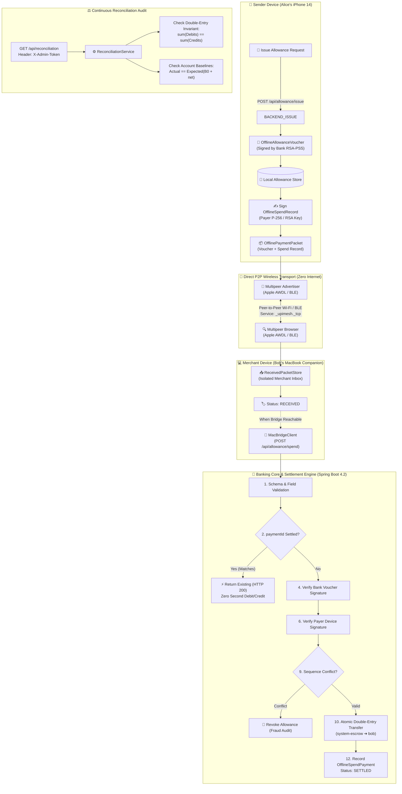
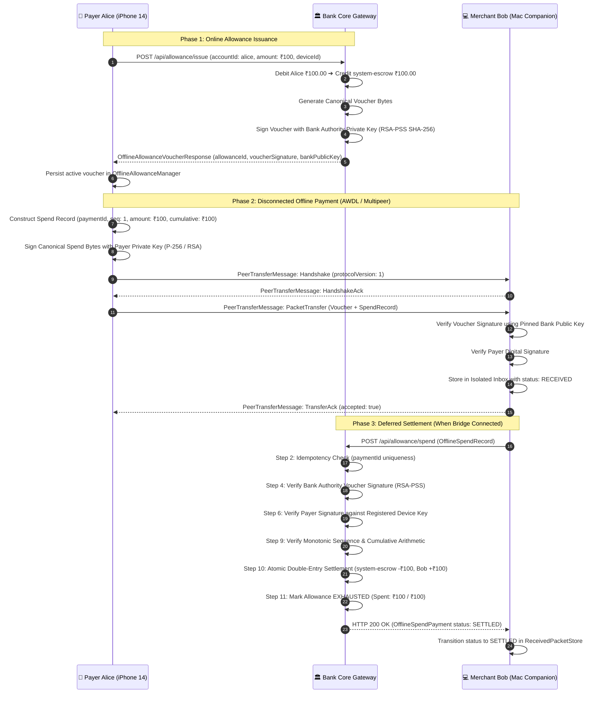

<div align="center">

# 🌐 MeshPay / UPI Offline Mesh

### *Decentralized, Peer-to-Peer Offline Payment Routing with Dual Cryptographic Signatures, Direct Apple Wireless Multipeer Transport, Bank-Issued Allowance Vouchers, Persistent Replay Idempotency & Mathematical Double-Entry Ledger Reconciliation*

[](https://openjdk.org/)
[](https://spring.io/projects/spring-boot)
[](https://github.com/Jarjis-Alam/upimesh)
[](https://github.com/Jarjis-Alam/upimesh)
[](https://github.com/Jarjis-Alam/upimesh)
[](https://github.com/Jarjis-Alam/upimesh)
[](https://github.com/Jarjis-Alam/upimesh)
[](https://opensource.org/licenses/Apache-2.0)

<br/>

[About](#-about-the-project) •
[Physical Milestone](#-physical-device-milestone-verified-100-payment) •
[Core Capabilities](#-core-capabilities) •
[System Architecture](#-system-architecture) •
[Cryptographic Pipeline](#-dual-signature-cryptographic-pipeline) •
[Direct P2P Transport](#-direct-offline-peer-to-peer-transport) •
[iOS & macOS Apps](#-native-apps-ios--macos) •
[Quickstart](#-quickstart-guide) •
[API Reference](#-api-reference) •
[Reconciliation Engine](#-mathematical-reconciliation-engine) •
[Test Suite](#-test-suite--verification-396-passing-tests) •
[Security Model & Boundaries](#-security-model--threat-boundaries) •
[Documentation Index](#-documentation-index)

---

</div>

## 📖 About the Project

### The Connectivity Bottleneck in Digital Payments
The Unified Payments Interface (UPI) handles billions of transactions monthly, powering financial inclusion. However, its foundational premise is **continuous, synchronous cellular or internet connectivity** linking mobile clients, telecom infrastructure, banking switches, and the central NPCI network.

When telecom links sever, digital payments cease entirely. Critical real-world scenarios include:
- **Disaster Zones & Power Grid Outages**: Severe weather, earthquakes, or substation blackouts severing cell towers.
- **Underground Transit & Remote Topography**: Subways, basements, deep tunnels, and remote mountainous transit lacking radio penetration.
- **High-Density Congestion**: Music festivals, crowded bazaars, and stadiums where cell towers suffer radio bandwidth exhaustion.
- **Rural & Underserved Regions**: Connectivity-sparse corridors where merchant-customer proximity exists without continuous cloud backhaul.

---

### The Architecture: Allowance-Backed P2P Mesh with Authoritative Escrow
**MeshPay / UPI Offline Mesh** resolves this bottleneck through a peer-to-peer, store-and-forward architecture built on **bank-issued cryptographic allowances** and **direct device-to-device wireless transport**:

1. **Pre-Authorized Bank Allowance**: While online, the payer reserves funds from their balance into bank escrow (`system-escrow`). The banking core issues a digitally signed `OfflineAllowance` voucher authenticated with **RSA-PSS (SHA-256)**.
2. **Dual-Signature Scheme**: Offline payments require two distinct signatures:
   - **Bank Authority Voucher Signature**: Proves the existence of genuine reserved escrow funds.
   - **Payer Device Signature**: Proves authentic instruction consent signed on-device via **P-256 ECDSA** or **RSA-PSS**.
3. **Zero-Internet Wireless Exchange**: The payer transmits the signed payment packet to the merchant over Apple's **Multipeer Connectivity framework** (Wi-Fi Direct / Apple Wireless Direct Link / Bluetooth Low Energy) with zero cellular, Wi-Fi router, or internet access.
4. **Deterministic Canonicalization (RFC 8785 subset)**: Custom canonical JSON serialization in Swift and Java guarantees byte-for-byte deterministic signature verification across iOS and Spring Boot.
5. **Isolated Receiver Inbox**: The merchant companion records the payment in an isolated storage inbox (`RECEIVED`) without mixing it into outgoing transfer queues.
6. **Delayed Bridge Settlement & Persistent Idempotency**: When a node reaches connectivity, it submits the spend record to the bank bridge. The settlement engine executes an atomic double-entry transfer from escrow to the merchant, enforces strict sequence monotonic timestamps, audits for sequence forks, and enforces persistent replay idempotency.
7. **Mathematical Double-Entry Reconciliation**: A decoupled audit engine mathematically verifies total double-entry conservation ($\sum \text{Debits} \equiv \sum \text{Credits}$) and reconciles all account closing balances against opening baselines.

---

## 🏆 Physical Device Milestone: Verified ₹100 Payment

The architecture has been proven end-to-end on **physical testbed hardware** (Physical iPhone 14 + MacBook Pro merchant node + Spring Boot backend on a persistent H2 database):

- **Payment ID**: `dd3bd00c-646a-4d8d-9fb2-828505c3e9b4`
- **Payer**: Alice (`alice`) $\rightarrow$ **Merchant**: Bob (`bob`)
- **Amount**: **₹100.00 INR** (Sequence 1)
- **Settlement Status**: `SETTLED` (Escrow debited ₹100; Bob credited ₹100)
- **Payer Post-Payment Balance**: ₹4,870.00 (from ₹5,000.00 opening balance; ₹100 settled, ₹30 prior online transfer)
- **Recipient Post-Payment Balance**: ₹1,130.00 (from ₹1,000.00 opening balance; ₹100 credited, ₹30 prior online transfer)
- **Escrow Balance**: ₹0.00 (fully settled and cleared)
- **Double-Entry Ledger Status**: **BALANCED** ($\sum \text{Debits} = \text{₹430.00} \equiv \sum \text{Credits} = \text{₹430.00}$)
- **Replay Protection**: Verified that replaying the identical payment instruction returns **HTTP 200 OK** without crediting the merchant a second time.

Detailed hardware verification data is preserved in [`docs/reports/hardware_verification_report_100_inr.md`](docs/reports/hardware_verification_report_100_inr.md).

---

## 🚀 Core Capabilities

- **🔐 Dual Cryptographic Authentications**: Bank authority voucher signing with **2048-bit RSA-PSS**; payer client signing with **P-256 ECDSA** or **RSA-PSS** bound to registered device identities.
- **🛡️ Authenticated Key Storage at Rest**: The Bank Authority master private key is protected at rest with **AES-256-GCM** using externally provisioned secrets (`UPI_MESH_KEY_ENCRYPTION_KEY`).
- **🔒 Scoped Administrative Access Control**: Fail-closed token authentication (`UPI_MESH_ADMIN_TOKEN` / `X-Admin-Token` header) on reconciliation, sensitive audits, and device authorization.
- **📡 Direct Wireless P2P Transport (Multipeer Connectivity)**: Physical iPhones and Mac companion nodes discover peers and transfer payment packets offline over peer-to-peer Wi-Fi and Bluetooth (`_upimesh._tcp`).
- **⚡ Step 2 Replay Protection & Idempotency**: Persistent database uniqueness checks intercept replayed payment IDs before balance modifications or allowance alterations, returning idempotent HTTP 200 responses.
- **⚖️ Double-Entry Ledger & Continuous Audit Engine**: Optimistic concurrency locking (`@Version`); read-only mathematical reconciliation audit checking $\sum \text{Debits} \equiv \sum \text{Credits}$ and $E(i) = B_0(i) + \Delta(i)$.
- **🚨 Sequence Fork & Fraud Detection**: Conflicting spend payments claiming the same sequence number trigger automatic `SEQUENCE_FORK_CONFLICT` security events and immediately revoke the parent allowance.
- **📱 Native Apple Clients**: Full SwiftUI iOS mobile application (**Liquid Mesh UPI**) and native code-signed macOS Companion application.

---

## 🏛️ System Architecture



---

## 🔒 Dual-Signature Cryptographic Pipeline



---

## 📡 Direct Offline Peer-to-Peer Transport

- **Zero Cellular / Zero Wi-Fi Router**: Direct communication over Apple Wireless Direct Link (AWDL) and Bluetooth Low Energy via Apple's **Multipeer Connectivity framework**.
- **Bonjour Service**: Registered under `_upimesh._tcp`.
- **Peer Roles**:
  - `MCNearbyServiceAdvertiser`: Broadcasts device availability and identity metadata.
  - `MCNearbyServiceBrowser`: Discovers nearby peer nodes in real-time.
- **Type-Safe Wire Protocol**:
  ```swift
  public enum PeerTransferMessage: Codable {
      case handshake(HandshakePayload)
      case handshakeAck(HandshakeAckPayload)
      case packetTransfer(PacketTransferPayload)
      case transferAck(TransferAckPayload)
      case ping(PingPayload)
      case pong(PongPayload)
  }
  ```
- **Diagnostic Ping/Pong**: Includes round-trip latency measurement over Multipeer Connectivity without financial mutations.

---

## 📱 Native Apps: iOS & macOS

### 1. Native iOS Client (Liquid Mesh UPI)
Located in [`ios/UPIMesh/`](ios/UPIMesh/), written in Swift / SwiftUI:
- **Mesh Wallets**: Real-time account balance display, bank device key registration, and one-tap allowance issuance.
- **Offline Pay**: Discovers nearby merchants, creates signed spend records, manages outgoing packet queue, and displays active allowance limits.
- **Mesh Radar**: Visualizes nearby peer nodes, signal strength (RSSI), and connection states.
- **Mesh Ledger**: Live transaction audit log synchronized with the backend.

### 2. Native macOS Companion App
Located in [`macos/UPIMeshCompanion/`](macos/UPIMeshCompanion/):
- **Merchant Role**: Runs as Merchant Bob on macOS, advertising via Multipeer Connectivity.
- **Isolated Receiver Inbox**: Stores incoming payments, verifies mathematical signatures locally, and displays canonical payloads.
- **Bridge Sync**: Connects to the Spring Boot backend (`MacBridgeClient.swift`) to submit offline spend records upon reconnection.
- **Zero-Dependency Build**: Includes standalone compile script [`build_macos_companion.sh`](build_macos_companion.sh) producing a code-signed application bundle.

---

## 🛠️ Quickstart Guide

### Prerequisites
- **Java**: OpenJDK 17 or higher
- **Maven**: Maven Wrapper (`./mvnw`) included
- **macOS**: macOS 14.0+ (Sonoma or Sequoia)
- **Xcode**: Xcode 15+ or 16+ Command Line Tools

---

### 1. Build and Run Backend
```bash
# Clone the repository
git clone https://github.com/Jarjis-Alam/upimesh.git
cd upimesh

# Compile backend
./mvnw clean compile

# Run all 303 Java backend tests
./mvnw test

# Configure environment variables
export UPI_MESH_ADMIN_TOKEN="your-secure-admin-token-min-16-chars"
# Optional AES-256-GCM encryption key for bank authority master key
# export UPI_MESH_KEY_ENCRYPTION_KEY="<BASE64_32_BYTE_KEY>"

# Start the Spring Boot server
./mvnw spring-boot:run
```

- **API Base URL**: `http://localhost:8080`
- **H2 Console**: `http://localhost:8080/h2-console` (`jdbc:h2:file:./data/upimesh`, User: `sa`, Password: *(blank)*)

---

### 2. Run the Native Swift Test Suite (83 Tests)
Run all 83 iOS and macOS tests directly from Terminal without opening Xcode:
```bash
./run_ios_tests.sh
```

---

### 3. Build & Run macOS Companion App
```bash
# Build standalone code-signed companion app
./build_macos_companion.sh

# Launch the app
open macos/build/UPIMeshCompanion.app
```

---

### 4. Run the iOS Mobile App
```bash
open ios/UPIMesh/UPIMesh.xcodeproj
```
Select an **iOS Simulator** or connected physical iPhone (iOS 16+), then press **⌘R**.

---

### 5. Controlled Technical Demonstration
For a safe, 100% read-only technical walkthrough that demonstrates the verified ₹100 payment and zero-sum reconciliation without database mutations, follow:
👉 **[`docs/reports/demo_runbook.md`](docs/reports/demo_runbook.md)**

---

## 📡 API Reference

### 1. Bank Authority & Allowance Endpoints

#### `GET /api/allowance/bank-public-key`
Retrieves the active Bank Authority RSA public key in standard X.509 Base64 format.
```bash
curl -s http://localhost:8080/api/allowance/bank-public-key
```
**Response (`200 OK`):**
```json
{
  "keyId": "bank-authority-master",
  "algorithm": "RSA",
  "publicKeyBase64": "MIIBIjANBgkqhkiG9w0BAQEFAAOCAQ8AMIIBCgKCAQEA..."
}
```

#### `POST /api/allowance/issue`
Reserves funds into escrow and issues an allowance voucher signed by the bank authority.
```bash
POST /api/allowance/issue
Content-Type: application/json

{
  "accountId": "alice",
  "allocatedAmount": 100.00,
  "currency": "INR",
  "deviceId": "85343D9B-10E3-4462-BE7F-0919CB8BA014",
  "validityDurationMinutes": 1440
}
```

#### `GET /api/allowance/{allowanceId}`
Queries the status, allocated amount, spent amount, and remaining balance of an allowance.

#### `GET /api/allowance/{allowanceId}/spends`
Returns all settled offline spend payments recorded against the allowance.

#### `POST /api/allowance/spend`
Settles an offline spend record submitted by a merchant node.

---

### 2. Core Ledger & Reconciliation Endpoints

#### `GET /api/reconciliation`
Runs an authoritative reconciliation audit. Requires administrative token authentication.
```bash
curl -s http://localhost:8080/api/reconciliation -H "X-Admin-Token: your-secure-admin-token-min-16-chars"
```
**Response (`200 OK`):**
```json
{
  "isReconciled": true,
  "isLedgerBalanced": true,
  "isBalancesReconciled": true,
  "structuralStatus": "BALANCED",
  "balanceStatus": "RECONCILED",
  "totalTransactionsChecked": 7,
  "totalLedgerDebits": 430.00,
  "totalLedgerCredits": 430.00,
  "systemZeroSumMaintained": true,
  "accountResults": [
    { "accountId": "alice", "actualBalance": 4870.00, "status": "RECONCILED", "matches": true },
    { "accountId": "bob", "actualBalance": 1130.00, "status": "RECONCILED", "matches": true },
    { "accountId": "carol", "actualBalance": 2000.00, "status": "RECONCILED", "matches": true },
    { "accountId": "system-escrow", "actualBalance": 0.00, "status": "RECONCILED", "matches": true }
  ],
  "discrepancies": [],
  "unverifiableAccounts": []
}
```

#### `GET /api/accounts`
Returns all registered account balances and optimistic locking versions.

#### `GET /api/transactions`
Returns the immutable, chronological double-entry transaction journal.

---

## ⚖️ Mathematical Reconciliation Engine

The reconciliation audit engine explicitly decouples **structural ledger invariants** from **account balance reconciliation**:

### 1. Structural Ledger Conservation Check
$$\sum_{j=1}^{M} \text{Debits}(j) \equiv \sum_{j=1}^{M} \text{Credits}(j)$$
- Validates double-entry symmetry across all settled journal entries.
- A balanced structural status proves internal journal equilibrium, but does not prove individual accounts were free of external balance manipulation.

### 2. Account Balance Verification
For each account $i$ with an authoritative opening baseline $B_0(i)$:
$$E(i) = B_0(i) + \sum \text{Credits}(i) - \sum \text{Debits}(i)$$
$$\Delta(i) = A(i) - E(i)$$
- **`RECONCILED`**: $\Delta(i) = 0$
- **`DISCREPANCY`**: $\Delta(i) \neq 0$ (flagged without silent database repairs)
- **`UNVERIFIABLE`**: If an account lacks an authoritative opening balance, it is explicitly classified as `UNVERIFIABLE`.

---

## 🧪 Test Suite & Verification (396 Passing Tests)

The repository is rigorously covered by **396 automated tests** with zero failures:
- **303 Java Backend Tests** (JUnit 5 + MockMvc + isolated in-memory H2 database `jdbc:h2:mem:upimesh_test`)
- **93 Swift iOS/macOS Tests** (command-line test runners with zero Xcode GUI dependency)

### Test Suite Breakdown

| Framework | Suite | Tests | Scope & Invariants Tested |
|---|---|:---:|---|
| **Java (Spring Boot)** | `OfflineAllowanceSettlementServiceTest` | 26 | Step 2 idempotency, dual signatures, sequence forks, escrow debit/credit |
| | `OfflineAllowanceServiceTest` | 13 | Allowance issuance, escrow reservation, refund, canonical voucher bytes |
| | `PaymentReconciliationSecurityTest` | 33 | Edge cases in reconciliation, partial opening balances, discrepancy audits |
| | `OperationalHardeningTest` | 13 | File database restart persistence, DataSeeder non-overwrite, sanitized errors |
| | `SecurityRemediationPhase1Test` | 8 | Timing-safe admin token validation, AES-256-GCM bank key encryption |
| | `SecurityRemediationPhase3Test` | 6 | Administrative access boundaries, environment variable resolution |
| | `BackendIntegrationLayerTest` | 15 | Bridge public key export, external packet ingestion, atomic settlement |
| | `DeviceSignedPaymentSubmissionTest` | 8 | Public key verification, device authorization, balance & replay defense |
| | `SecureDeviceAuthorizationTest` | 9 | Owner consent, pairing tokens, unauthorized & duplicate guards |
| | `PersistentDeviceRegistryTest` | 6 | Device registration persistence, key updates, account binding |
| | `CrossLanguageCanonicalizationTest` | 1 | RFC 8785 byte-for-byte serialization match between Java & Swift |
| | `LedgerReconciliationTest` | 9 | Double-entry invariants, circular transfers, tampering detection |
| | `SenderAuthenticationTest` | 9 | RSASSA-PSS SHA-256 signature verification, canonical byte serialization |
| | `PersistentReplayProtectionTest` | 7 | DB compound `(fromAccount, nonce)` uniqueness, re-encryption defense |
| | `PersistentIdempotencyTest` | 7 | Service re-instantiation idempotency, SHA-256 deduplication, concurrency |
| | `TransactionLedgerIntegrationTest` | 6 | Atomic ledger recording, balance adjustments, chronological indexing |
| | `BridgeIngestionServiceTest` | 10 | Hybrid decryption, payload validation, clock skew & expiration |
| | `MeshSimulatorServiceTest` | 5 | Multi-hop gossip rounds, loop prevention, TTL expiration |
| | `EndToEndMeshPaymentTest` | 5 | End-to-end controller & simulation integration |
| | `CryptoServiceTest` | 9 | RSA-OAEP key wrapping, AES-256-GCM ciphering, signature schemes |
| | `MeshPacketTest` & `PaymentInstructionTest` | 15 | Immutability, canonical representation, validation invariants |
| | `IdempotencyServiceTest` | 5 | Atomic in-memory claims, state lifecycle transitions |
| | *Other Core Spring Tests* | 68 | Entity mapping, repository queries, controller contracts |
| **Swift (iOS / macOS)** | `TrueOfflineStoreAndForwardTests` | 10 | Local creation without backend, persist-before-ack, crash recovery, delayed settlement |
| | `PeerTransportTests` | 22 | Multipeer handshake, packet serialization, inbox lifecycle, diagnostic ping/pong |
| | `ReconciliationServiceTests` | 16 | Settlement transitions, terminal rejections, timeout recovery, retry safety |
| | `MacCompanionTests` | 16 | macOS packet decoding, deduplication, tampering rejection, lifecycle states |
| | `OfflineAllowanceTests` | 13 | Voucher parsing, RSASSA-PSS verification, spend creation, cumulative tracking |
| | `OfflinePaymentPacketTests` | 9 | Packet creation, canonicalization, P-256 signing, deduplication |
| | `MeshLedgerViewModelTests` | 7 | Live backend transaction sync, offline local counts, preview isolation |
| **Total** | **26 Test Suites** | **396** | **396 Passed / 0 Failures / 0 Errors** |

---

## 🔒 Security Model & Threat Boundaries

> [!WARNING]
> **RESEARCH & EDUCATIONAL PROTOTYPE CLASSIFICATION**  
> MeshPay is an experimental prototype demonstrating distributed systems and cryptographic patterns for offline payments. It is not connected to live UPI / NPCI banking rails.

The system adheres to an honest security model and explicitly discloses inherent physical constraints:

1. **SEC-01 (Offline Double-Spending is an Inherent Architectural Limitation)**:
   - In disconnected peer-to-peer networks without central online authorization or tamper-proof monotonic hardware counters, a compromised payer device can present validly-signed vouchers to multiple disconnected merchants.
   - The first merchant to sync with the backend settles successfully; subsequent merchants incur a 100% credit loss. Offline transaction finality is **strictly provisional** until bridge settlement. Sequence forks are detected and trigger immediate allowance revocation.
2. **SEC-03 (Software Keychain vs. Hardware Secure Enclave)**:
   - Device keys are stored in the Apple iOS software Keychain (`kSecAttrAccessibleAfterFirstUnlockThisDeviceOnly`).
   - The Apple Secure Enclave processor lacks RSA hardware coprocessors and supports ECC NIST P-256 exclusively. Full hardware-enforced private-key attestation requires a Version 2 ECDSA migration.
3. **SEC-05 (Client-Signed Timestamps Do Not Establish True Time)**:
   - Server-side validation enforces syntactic timestamp bounds (`createdAt >= issuedAt - 5m`, allowance expiration, and sequence monotonicity).
   - However, a client-signed timestamp proves only that the private key signed that timestamp string, **not that the device clock was truthful**. Establishing trustworthy offline time without trusted hardware remains an open distributed systems challenge.

For the complete threat model and limitation analysis, see [`docs/security/security_model_and_limitations.md`](docs/security/security_model_and_limitations.md).

---

## 📚 Documentation Index

The `docs/` directory contains complete technical reports and verification gates:

- **[Demo Runbook (`docs/reports/demo_runbook.md`)](docs/reports/demo_runbook.md)**: Controlled step-by-step technical demonstration guide with safe read-only paths and sanitized secrets.
- **[Hardware Verification Report (`docs/reports/hardware_verification_report_100_inr.md`)](docs/reports/hardware_verification_report_100_inr.md)**: Complete empirical log and photographic evidence of the first ₹100 payment across physical iPhone 14 and MacBook Pro.
- **[Final Verification Gate (`docs/reports/final_verification_gate.md`)](docs/reports/final_verification_gate.md)**: Comprehensive, read-only audit verifying zero database mutations, test suites, and cryptographic integrity.
- **[Security Remediation Final Report (`docs/reports/security_remediation_final_report.md`)](docs/reports/security_remediation_final_report.md)**: Exhaustive documentation of all 12 security remediation phases (SEC-01 through SEC-12).
- **[Security Model & Limitations (`docs/security/security_model_and_limitations.md`)](docs/security/security_model_and_limitations.md)**: Detailed threat model, attacker assumptions, and structural boundaries.

---

## 📄 License

This project is licensed under the [Apache License 2.0](LICENSE).
