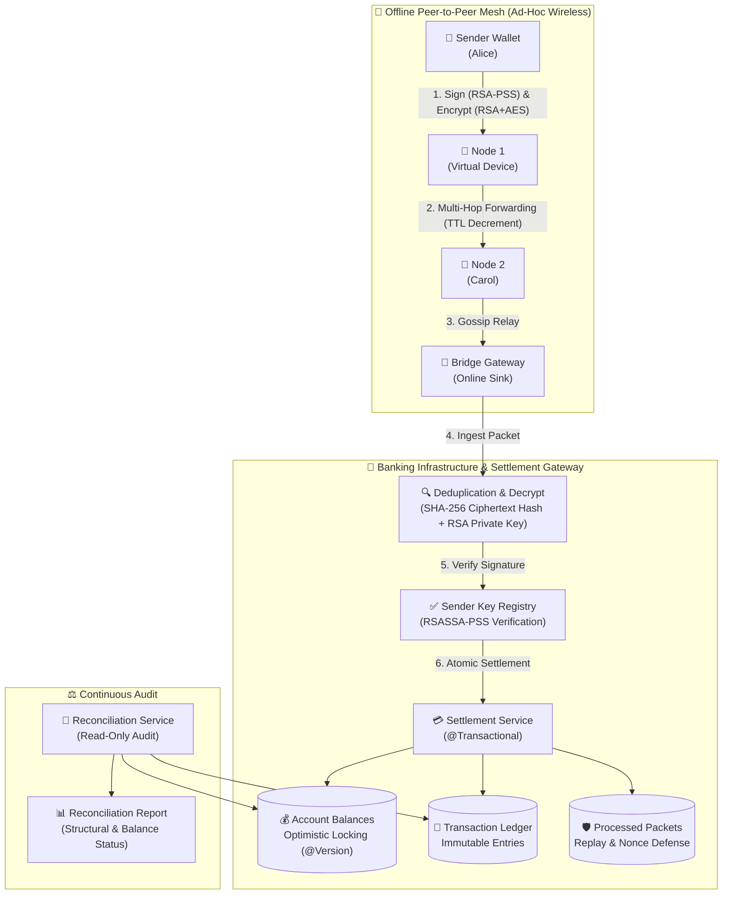
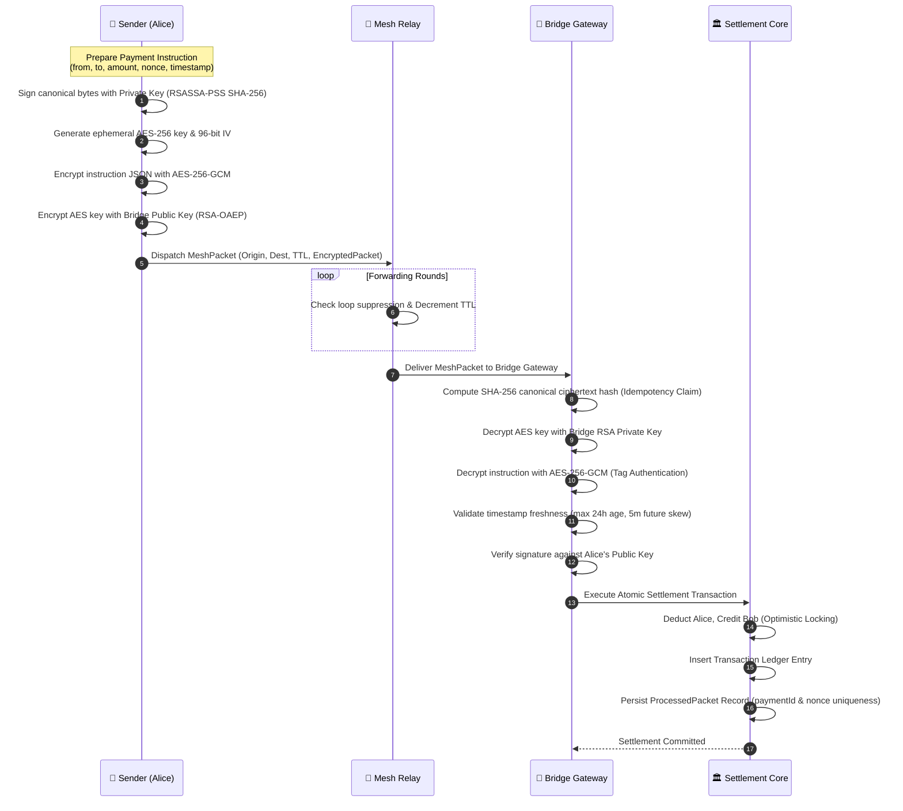
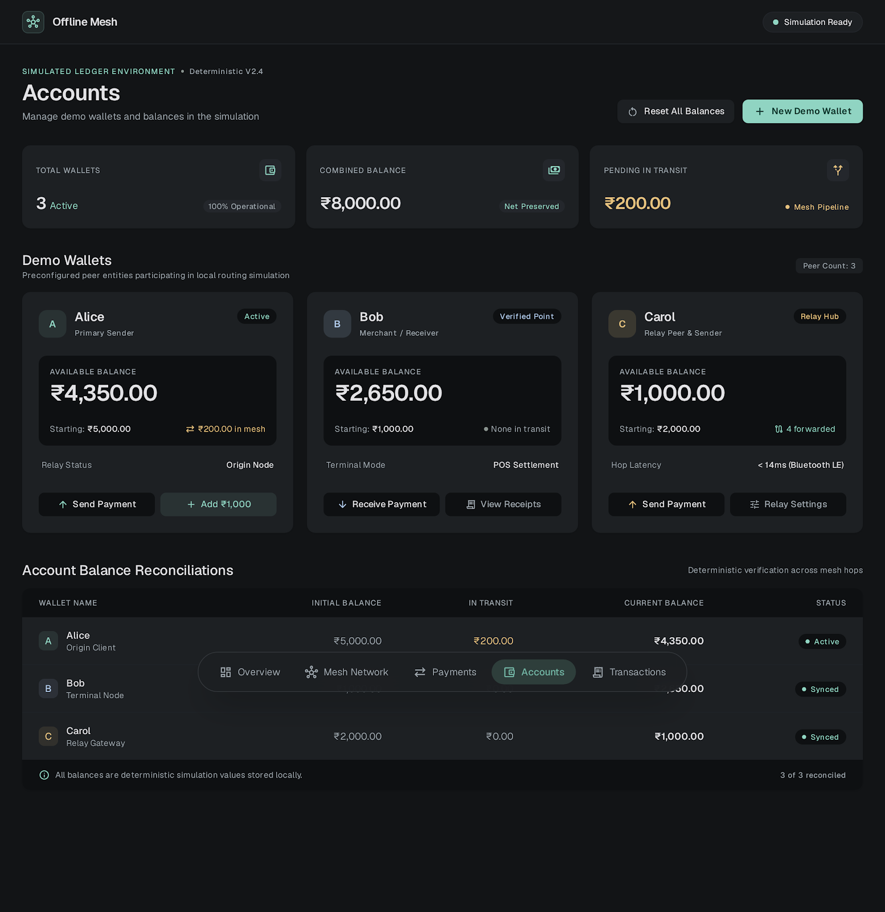
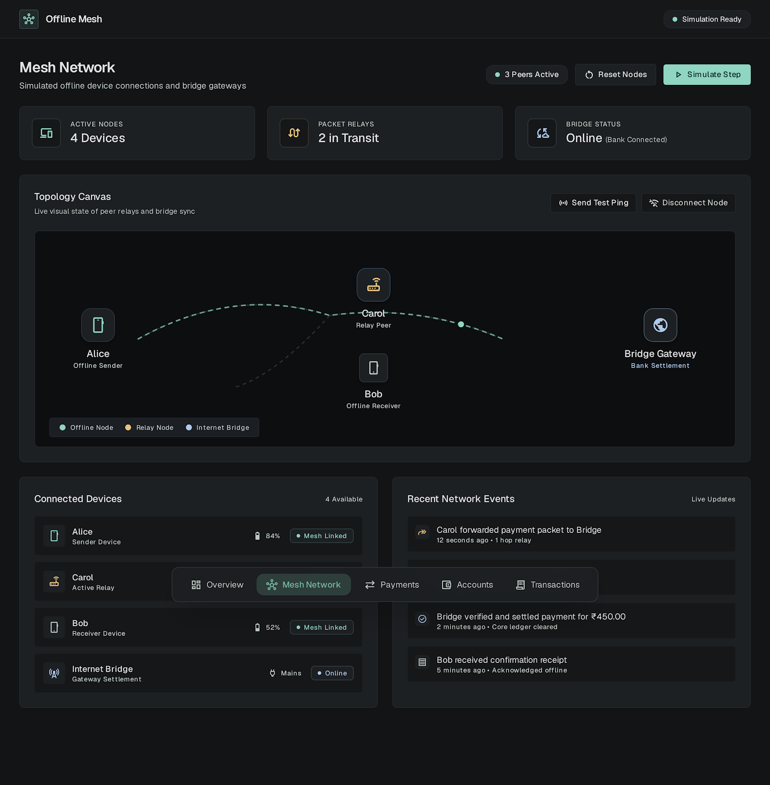
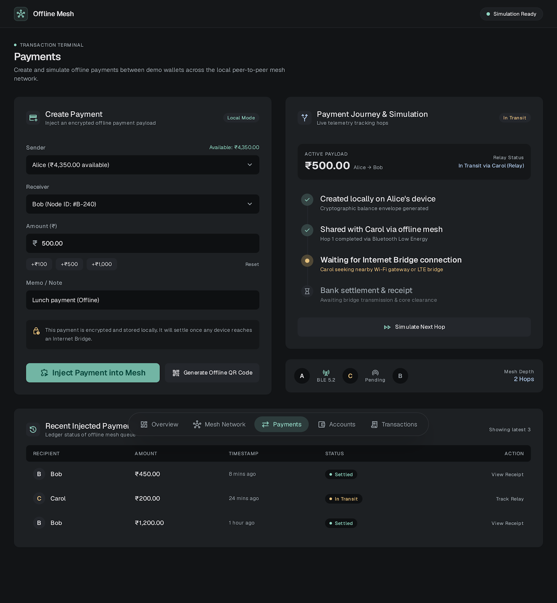
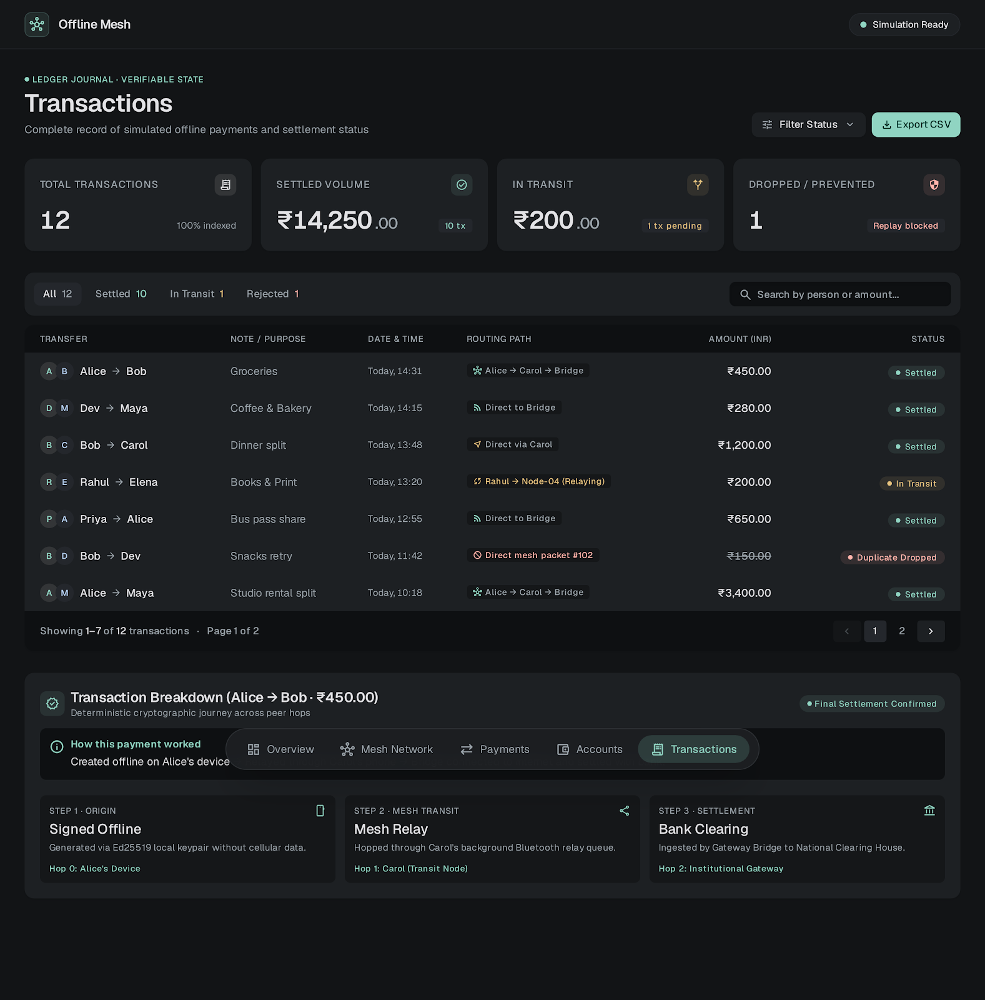

<div align="center">

# 🌐 UPI Offline Mesh Simulation Environment

### *Decentralized, Peer-to-Peer Offline Payment Routing with Cryptographic Sender Authentication, Persistent Replay Protection & Double-Entry Ledger Reconciliation*

[](https://openjdk.org/)
[](https://spring.io/projects/spring-boot)
[](https://github.com/Jarjis-Alam/upimesh)
[](https://github.com/Jarjis-Alam/upimesh)
[](https://github.com/Jarjis-Alam/upimesh)
[](https://opensource.org/licenses/Apache-2.0)

<br/>

[About](#-about-the-project) •
[Key Capabilities](#-key-capabilities) •
[Architecture](#-system-architecture) •
[Security Pipeline](#-cryptographic-security-pipeline) •
[Interactive Dashboard](#-interactive-dashboard) •
[Quickstart](#-quickstart-guide) •
[API Reference](#-api-reference) •
[Reconciliation Engine](#-mathematical-reconciliation-engine) •
[Test Suite](#-test-suite--verification)

---

</div>

## 📖 About the Project

### The Connectivity Problem in Digital Payments
The Unified Payments Interface (UPI) processes billions of transactions monthly, transforming digital commerce. However, its fundamental assumption is **continuous, end-to-end cellular or internet connectivity** between mobile clients, telecom infrastructure, banking switches, and the central NPCI network.

When connectivity drops, digital transactions fail entirely. Real-world scenarios include:
- **Disaster Zones & Outages**: Earthquakes, cyclones, or power grid failures that sever telecom towers.
- **Underground & Transit**: Underground metro stations, basements, highway tunnels, and remote railway routes.
- **High-Density Congestion**: Music festivals, stadiums, or demonstrations where cellular towers face bandwidth exhaustion.
- **Remote & Rural Areas**: Rural villages and hilly terrains lacking reliable cellular coverage.

---

### The Solution: Multi-Hop Store-and-Forward Mesh
**UPI Offline Mesh** introduces an opportunistic, multi-hop peer-to-peer architecture for offline payments. Rather than requiring direct cellular access to banking servers at the moment of payment:

1. **Local Offline Signing**: The payer creates a cryptographically signed payment instruction on their device using an asymmetric key pair (**RSASSA-PSS SHA-256**).
2. **Hybrid Envelope Encryption**: The instruction is encapsulated in an authenticated envelope (**RSA-OAEP** key wrapping + **AES-256-GCM** payload encryption) keyed exclusively to the bank's Bridge Gateway.
3. **Ad-Hoc Wireless Forwarding**: The encrypted envelope is transferred locally (via simulated peer-to-peer Bluetooth/Wi-Fi Direct hops). Nearby devices forward the opaque packet across the mesh without being able to read or modify its contents.
4. **Opportunistic Bridge Settlement**: As soon as *any* participating mesh device encounters internet connectivity (an edge bridge or cellular connection), it delivers the packet to the banking core.
5. **Atomic Ledger Settlement**: The backend bridge authenticates the digital signature, verifies sender balance, guarantees persistent idempotency, and records an immutable double-entry ledger entry.

---

### 🔍 How It Compares

| Feature | Standard Online UPI | UPI Lite X (NFC) | **UPI Offline Mesh** |
|---|:---:|:---:|:---:|
| **Internet Required at Payment Time** | ✅ Mandatory (Both parties) | ❌ Offline Tap | ❌ **100% Offline (Zero Internet)** |
| **Direct Proximity to Merchant Only** | N/A | ✅ Mandatory (1-to-1 Tap) | ❌ **Multi-hop peer forwarding** |
| **Relay Capability** | ❌ No | ❌ No | ✅ **Peer-to-peer opportunistic relays** |
| **Intermediate Relay Privacy** | N/A | N/A | ✅ **Zero-Knowledge (Opaque Ciphertext)** |
| **Replay & Double-Spend Defense** | Central switch validation | Device wallet counters | ✅ **Compound DB constraints & Hash Claims** |
| **Ledger Reconciliation** | Immediate synchronous | Delayed sync | ✅ **Decoupled audit with mathematical proof** |

---

## 📌 Executive Summary

**UPI Offline Mesh** is a deterministic, software-simulated payment infrastructure that models and proves the correctness of **offline peer-to-peer transaction generation, multi-hop mesh forwarding, and deferred atomic settlement**. 

The system runs entirely as a self-contained Spring Boot application with zero external hardware requirements, providing a full suite of cryptographic primitives, gossip forwarding simulations, database-level replay protections, and an interactive glassmorphism web dashboard.

---

## 🚀 Key Capabilities

- **🔐 End-to-End Cryptographic Security**: Senders authenticate instructions with **RSASSA-PSS SHA-256** signatures; payloads are confidentiality-protected with hybrid **RSA-OAEP + AES-256-GCM** encryption.
- **🛡️ Zero-Trust Relay Privacy**: Intermediate forwarding devices inspect only transport envelopes. Payloads, amounts, sender/recipient identities, and cryptographic keys remain fully opaque to relays.
- **🔄 Multi-Hop Gossip Simulation**: Deterministic discrete rounds with loop suppression, visited-device memory, and Time-To-Live (TTL) hop decrementing without physical radio hardware dependencies.
- **⚡ Persistent Replay Protection**: Multi-layered defense coupling canonical SHA-256 ciphertext deduplication, global `paymentId` uniqueness, and persistent `(fromAccount, nonce)` uniqueness constraints.
- **⚖️ Double-Entry Ledger & Audit Reconciliation**: Strict atomic balance movements recorded alongside transactional ledger rows; decoupled read-only reconciliation auditing individual balances against authoritative opening baselines.
- **🖥️ Stitch Web Dashboard**: Live web UI visualizing account balances, real-time simulated transfers, dynamic mesh topology, and ledger history.

---

## 🏛️ System Architecture



---

## 🔒 Cryptographic Security Pipeline



---

## 🖥️ Interactive Dashboard

The application includes a responsive web interface located at `/dashboard.html` that interfaces with the Spring Boot backend in real time:

| Screen | Overview |
|:---:|:---:|
| **Account Overview & Balances**<br/>Real-time balances for Alice, Bob, and Carol |  |
| **Mesh Topology & Routing**<br/>Simulated multi-hop device graph and bridge connectivity |  |
| **Simulated Payment Dispatch**<br/>End-to-end cryptographic mesh transfer execution |  |
| **Transaction Ledger**<br/>Chronological, immutable record of settled transactions |  |

---

## 🛠️ Quickstart Guide

### Prerequisites
- **JDK**: Java 17 or higher
- **Maven**: Maven Wrapper (`./mvnw`) is included

### 1. Clone & Build
```bash
git clone https://github.com/Jarjis-Alam/upimesh.git
cd upimesh
./mvnw clean compile
```

### 2. Run the Application
```bash
./mvnw spring-boot:run
```

Once started, open your browser:
- **Interactive Dashboard**: [http://localhost:8080/dashboard.html](http://localhost:8080/dashboard.html)
- **H2 Web Console**: [http://localhost:8080/h2-console](http://localhost:8080/h2-console)
  - **JDBC URL**: `jdbc:h2:file:./data/upimesh`
  - **User**: `sa`
  - **Password**: *(leave blank)*

### 3. Run the Test Suite
```bash
./mvnw test
```
All **100 tests** execute and pass in an isolated in-memory H2 database.

---

## 📡 API Reference

### 1. Query Accounts
```bash
GET /api/accounts
```
**Response (`200 OK`):**
```json
[
  { "id": "alice", "balance": 5000.00, "version": 0 },
  { "id": "bob", "balance": 1000.00, "version": 0 },
  { "id": "carol", "balance": 2000.00, "version": 0 }
]
```

---

### 2. Execute Direct Transfer
```bash
POST /api/transfer?from=alice&to=bob&amount=250.00
```
**Response (`200 OK`):**
```
OK
```

---

### 3. Simulate End-to-End Mesh Payment
Executes complete 4-stage pipeline: signing, hybrid encryption, multi-hop mesh forwarding, bridge ingestion, and settlement.
```bash
POST /api/mesh/transfer?from=alice&to=bob&amount=175.00&ttl=5
```
**Response (`200 OK`):**
```json
{
  "success": true,
  "paymentId": "5c11d041-e945-4299-bb6e-827eb0c8a3cf",
  "packetId": "d3472091-a1e6-42d4-bb6c-1793ecff6eb7",
  "fromAccount": "alice",
  "toAccount": "bob",
  "amount": 175.00,
  "roundsRun": 2,
  "hopsTaken": 2,
  "remainingTtl": 3,
  "routeTrace": ["alice", "carol", "bridge"],
  "encryptedKeySnippet": "qP9F7k3Lm01Z9aX8...",
  "ivHex": "8d3e41b2190fc61a49ab88c0",
  "ciphertextSnippet": "54a9d77f28bc0192...",
  "status": "SETTLED",
  "message": "Payment of ₹175.00 authenticated via RSA-PSS, routed via 2 hops and settled atomically at Bridge Gateway."
}
```

---

### 4. Query Transaction Ledger
```bash
GET /api/transactions
```
**Response (`200 OK`):**
```json
[
  {
    "id": "e93ab630-f921-4f40-8774-681b490f23be",
    "fromAccount": "alice",
    "toAccount": "bob",
    "amount": 175.00,
    "status": "SETTLED",
    "timestamp": "2026-10-12T09:44:28.109Z"
  }
]
```

---

### 5. Run Ledger Reconciliation Audit
```bash
GET /api/reconciliation
```
**Response (`200 OK`):**
```json
{
  "isReconciled": true,
  "isLedgerBalanced": true,
  "isBalancesReconciled": true,
  "structuralStatus": "BALANCED",
  "balanceStatus": "RECONCILED",
  "reconciledAt": "2026-10-12T09:44:28.614Z",
  "totalTransactionsChecked": 1,
  "totalLedgerDebits": 175.00,
  "totalLedgerCredits": 175.00,
  "systemZeroSumMaintained": true,
  "accountResults": [
    {
      "accountId": "alice",
      "openingBalance": 5000.00,
      "totalCredits": 0.00,
      "totalDebits": 175.00,
      "netMovement": -175.00,
      "expectedBalance": 4825.00,
      "actualBalance": 4825.00,
      "discrepancy": 0.00,
      "status": "RECONCILED",
      "matches": true
    },
    {
      "accountId": "bob",
      "openingBalance": 1000.00,
      "totalCredits": 175.00,
      "totalDebits": 0.00,
      "netMovement": 175.00,
      "expectedBalance": 1175.00,
      "actualBalance": 1175.00,
      "discrepancy": 0.00,
      "status": "RECONCILED",
      "matches": true
    }
  ],
  "discrepancies": [],
  "unverifiableAccounts": []
}
```

---

## ⚖️ Mathematical Reconciliation Engine

Reconciliation decouples **structural journal invariants** from **individual account balance verification**:

### 1. Structural Ledger Check
$$\sum \text{Debits} \equiv \sum \text{Credits}$$
- Validates double-entry symmetry across the journal.
- **Important**: A balanced ledger proves internal consistency, but does **not** prove individual balances are free of external tampering.

### 2. Account Balance Verification
For each account $i$ with authoritative opening baseline $B_0(i)$:
$$E(i) = B_0(i) + \text{Credits}(i) - \text{Debits}(i)$$
$$\Delta(i) = A(i) - E(i)$$
- **Reconciled**: $\Delta(i) = 0$
- **Discrepancy**: $\Delta(i) \neq 0$ (reported without silent mutations)
- **Unverifiable**: If $B_0(i)$ is missing, the account is explicitly marked `UNVERIFIABLE`.

---

## 🧪 Test Suite & Verification

The project includes **100 automated tests** across 13 test suites:

```
[INFO] Results:
[INFO] Tests run: 100, Failures: 0, Errors: 0, Skipped: 0
[INFO] BUILD SUCCESS
```

| Suite | Tests | Verification Area |
|---|:---:|---|
| `OperationalHardeningTest` | 13 | Restart persistence, DataSeeder non-overwrite, sanitized API errors, endpoint security |
| `LedgerReconciliationTest` | 9 | Double-entry invariants, circular transfers, tampering detection, decoupled audit statuses |
| `SenderAuthenticationTest` | 9 | RSASSA-PSS SHA-256 signature verification, canonical byte serialization, tamper rejection |
| `PersistentReplayProtectionTest` | 7 | DB-enforced compound `(fromAccount, nonce)` uniqueness, re-encryption defense |
| `PersistentIdempotencyTest` | 7 | Service re-instantiation idempotency, canonical SHA-256 deduplication, concurrency |
| `TransactionLedgerIntegrationTest` | 6 | Atomic ledger recording, balance adjustments, chronological indexing |
| `BridgeIngestionServiceTest` | 10 | Hybrid decryption, payload validation, clock skew & expiration thresholds |
| `MeshSimulatorServiceTest` | 5 | Multi-hop gossip rounds, loop prevention, TTL expiration |
| `EndToEndMeshPaymentTest` | 5 | End-to-end controller & simulation integration |
| `CryptoServiceTest` | 9 | RSA-OAEP key wrapping, AES-256-GCM ciphering, signature schemes |
| `MeshPacketTest` & `PaymentInstructionTest` | 14 | Value object immutability, canonical representation, validation invariants |
| `IdempotencyServiceTest` | 5 | Atomic in-memory claims, state lifecycle transitions |
| `UpimeshApplicationTests` | 1 | Spring Boot ApplicationContext bootstrapping |

---

## 🔒 Security & Prototype Limitations

> [!WARNING]
> This repository is an educational prototype and architectural simulation of offline UPI concepts. It does not claim production-grade compliance with NPCI / RBI banking standards.

1. **Hardware Root of Trust**: In production offline UPI, private keys must be stored in hardware secure elements (e.g., SIM Card SE, Android StrongBox Keymaster, eSE) requiring biometric or PIN unlock. Here, keys are managed in-memory.
2. **Physical Wireless Layer**: Relays are simulated in software. Physical wireless deployment (BLE, Wi-Fi Direct, LoRa) requires Link Layer Encryption and RF-level replay suppression.
3. **PKI Infrastructure**: Key distribution uses an in-memory registry. Production deployment requires X.509 certificates chained to verified banking root authorities.

---

## 📄 License

This project is licensed under the [Apache License 2.0](LICENSE).
