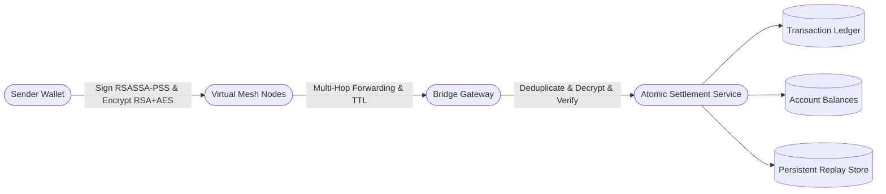

# UPI Offline Mesh Simulation Environment

A deterministic simulation and prototype for offline, peer-to-peer UPI payments over simulated wireless mesh networks with cryptographic authentication, persistent idempotency, double-entry ledger settlement, and read-only reconciliation.

---

## 🌟 Architecture & Key Features



### 1. Cryptographic Security & Sender Authentication
- **Digital Signatures**: Senders sign canonical payment instructions using **RSASSA-PSS SHA-256**.
- **Confidentiality & Integrity**: Payloads are encrypted using hybrid encryption (**RSA-OAEP** session key exchange + **AES-256-GCM** authenticated payload encryption).
- **Relay Privacy**: Intermediate mesh nodes forward opaque ciphertext envelopes without access to payment metadata or keys.

### 2. Multi-Hop Mesh Simulation
- **Deterministic Discrete Gossip Rounds**: Zero physical hardware required; deterministic routing, hop counts, and TTL decrements.
- **Loop Suppression**: Devices record observed packet IDs to prevent forwarding loops.

### 3. Persistent Idempotency & Replay Protection
- **Multi-Layer Defense**:
  - SHA-256 canonical ciphertext hash deduplication.
  - Global `paymentId` uniqueness in persistent database.
  - Compound `(fromAccount, nonce)` uniqueness constraint preventing payload re-encryption attacks.
- **Atomic Database Coordination**: Replays are rejected at the database level inside the same transaction boundary as balance adjustments.

### 4. Hardened Ledger & Reconciliation Engine
- **Atomic Ledger**: Every successful transfer creates exactly one immutable transaction record.
- **Zero-Sum Double-Entry Conservation**: System-wide check verifying $\sum \text{debits} == \sum \text{credits}$.
- **Decoupled Reconciliation**: Strictly read-only verification calculating:
  $$\text{Expected Closing Balance} = \text{Authoritative Opening Balance} + \text{Credits} - \text{Debits}$$
- **Discrepancy Reporting**: Detects database tampering or out-of-band balance modifications without mutating accounts or ledger entries.

### 5. Interactive Dashboard
- Integrated responsive web dashboard (Stitch UI) at `/dashboard.html` for monitoring account balances, initiating mesh payments, observing multi-hop routing, and auditing transaction history.

---

## 🚀 Getting Started

### Prerequisites
- Java 17+
- Maven wrapper (included)

### Running Locally
```bash
./mvnw spring-boot:run
```

Once running, access the dashboard at:
- **Dashboard**: [http://localhost:8080/dashboard.html](http://localhost:8080/dashboard.html)
- **H2 Local Console**: [http://localhost:8080/h2-console](http://localhost:8080/h2-console) (JDBC URL: `jdbc:h2:file:./data/upimesh`, User: `sa`, Password: *empty*)

### Running Tests
The project contains 100 comprehensive unit, integration, concurrency, and security tests:
```bash
./mvnw test
```

---

## 📡 API Endpoints

| Method | Endpoint | Description |
|---|---|---|
| `GET` | `/api/accounts` | Retrieve all accounts and current balances |
| `GET` | `/api/transactions` | Retrieve transaction ledger history (newest first) |
| `POST` | `/api/transfer?from=&to=&amount=` | Execute direct account-to-account transfer |
| `POST` | `/api/mesh/transfer?from=&to=&amount=&ttl=` | Execute end-to-end simulated mesh payment |
| `GET` | `/api/mesh/topology` | View simulated mesh nodes and bridge status |
| `GET` | `/api/reconciliation` | Run read-only ledger reconciliation audit report |

---

## 🛡️ Operational Hardening

- **Data Persistence**: File-backed H2 database stored at `./data/upimesh.mv.db`.
- **Database Reset**: Safe local reset procedure by removing `./data` folder (`rm -rf ./data`).
- **Information Leakage**: Stack traces and internal secrets are suppressed in API responses (`server.error.include-stacktrace=never`).
- **Test Isolation**: In-memory database used for automated tests (`jdbc:h2:mem:upimesh_test`), protecting development data from corruption.
