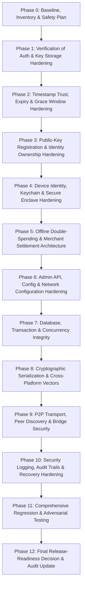

# MeshPay — Security Remediation Master Plan & Baseline Inventory

**Date**: October 17, 2026  
**Document Version**: 1.0  
**Project**: MeshPay / UPI Offline Mesh  
**Workspace Root**: `/Users/munshijarjisalam/Documents/Projects/upimesh`  
**Persistent Database**: `./data/upimesh.mv.db` (Read-only verified; strictly preserved)  
**Target Milestone**: Preservation of Verified ₹100 Physical-Device Offline Payment (`dd3bd00c-646a-4d8d-9fb2-828505c3e9b4`)

---

## 1. Executive Mission & Baseline State

### 1.1 Objective
Systematically remediate, test, harden, and document every security finding from the release-readiness audit across the entire MeshPay architecture (Spring Boot backend, iOS client, and macOS bridge companion). 

This plan establishes strict procedural invariants, phase execution order, test isolation mechanisms, and cryptographic continuity requirements to ensure that no changes jeopardize historical payment records, bank authority credentials, or ledger zero-sum balance invariants.

### 1.2 Baseline Inventory & Verified System State

| Dimension | Baseline State | Verification Method |
| :--- | :--- | :--- |
| **Payer Account** | `alice` — Balance: ₹4,870.00 (version 6) | Live REST query (`/api/accounts`) |
| **Recipient Account** | `bob` — Balance: ₹1,130.00 (version 4) | Live REST query (`/api/accounts`) |
| **Reference Account** | `carol` — Balance: ₹2,000.00 (version 0) | Live REST query (`/api/accounts`) |
| **System Escrow** | `system-escrow` — Balance: ₹0.00 (version 4) | Live REST query (`/api/accounts`) |
| **Total Ledger Balance** | **₹8,000.00** (Zero-sum maintained; Opening: ₹8,000.00) | Live REST query (`/api/reconciliation`) |
| **Total Debits / Credits** | ₹430.00 Debits / ₹430.00 Credits across 7 transactions | Live REST query (`/api/reconciliation`) |
| **Bank Authority Key ID** | `bank-authority-master` | Live REST query (`/api/allowance/bank-public-key`) |
| **Bank Authority Public Key** | RSA 2048-bit (`MIIBIjANBgkqhkiG9w0BAQEFAAOCAQ8AMIIBCg...QIDAQAB`) | SHA-256 fingerprint verified |
| **Physical Hardware Payment** | Payment ID: `dd3bd00c-646a-4d8d-9fb2-828505c3e9b4` Allowance: `alw-d5e534d7-fc4e-478e-82fb-2cb55be77df0` Sequence: 1, Amount: ₹100.00, Status: `SETTLED` | `hardware_verification_report_100_inr.md` |
| **Companion Storage** | `~/Library/Application Support/UPIMeshCompanion/received_packets.json` | JSON store inspection |
| **Persistent DB File** | `./data/upimesh.mv.db` (110,592 bytes) | File system check; locked by PID 12212 |

---

## 2. Absolute Safety Boundaries

The following non-negotiable constraints govern all execution phases:

1. **No Database Reset or Reseed**: `./data/upimesh.mv.db` will never be deleted, overwritten, re-seeded, or truncated.
2. **Test Isolation**: All automated tests (`./mvnw test`) execute strictly against an isolated in-memory database (`jdbc:h2:mem:upimesh_test;DB_CLOSE_DELAY=-1`) defined in `src/test/resources/application.properties`.
3. **No Financial Operations During Remediation**: No new allowances, offline payments, transfers, or refunds will be executed against the persistent development database.
4. **Bank Authority Key Continuity**: The RSA-2048 bank authority keypair must never be silently rotated. If decryption or loading fails, the system fails closed immediately (`IllegalStateException`).
5. **No Permissive Fallbacks**: Cryptographic signature validation failures, missing authentication tokens, or expired allowances must fail closed.
6. **No Git Discards or Unapproved Pushes**: All changes remain uncommitted in the local working tree. No `git reset --hard`, `git clean -fd`, `git push`, or `git commit` commands will be proposed or executed without explicit user instruction.
7. **Zero-Sum Ledger Invariant**: The total system ledger balance across all accounts and escrow must remain invariant:
   $$\sum \text{Account Balances} + \text{Escrow Balance} = \text{Opening Balance Total} = ₹8,000.00$$

---

## 3. Comprehensive Security Findings Matrix

| ID | Title | Severity | Category | Status Prior to Remediation | Remediation Phase |
| :--- | :--- | :--- | :--- | :--- | :--- |
| **SEC-01** | Disconnected Offline Double-Spending Causes 100% Merchant Loss | **CRITICAL** | Protocol / Distributed Systems | OPEN (Architectural constraint) | Phase 5 |
| **SEC-02** | Bank Authority Master Private Key Stored in Plaintext Database Column | **HIGH** | Cryptography / Key Storage | REMEDIATED (Phase 1 verified) | Phase 1 |
| **SEC-03** | Key Generation Uses Software Keychain, Not Hardware Secure Enclave | **HIGH** | Cryptography / Hardware Identity | OPEN (Accurately documented) | Phase 4 |
| **SEC-04** | Administrative Demo Token Enabled by Default in Runtime Properties | **MEDIUM** | Authentication & Access Control | REMEDIATED (Phase 1 verified) | Phase 1 |
| **SEC-05** | Client-Generated Timestamps Allow Backdated Spend Creation in Grace Window | **MEDIUM** | Temporal Validation & Replay | OPEN (Unvalidated client time) | Phase 2 |
| **SEC-06** | Unauthenticated Sender Key Registration (`/api/keys/register`) | **LOW** | Authorization & Key Binding | OPEN (First-to-register takeover) | Phase 3 |
| **SEC-07** | Hardcoded Local Machine IP Addresses in Client Default Configuration | **LOW** | Configuration & Portability | OPEN (`192.168.1.100` hardcoded) | Phase 6 |
| **SEC-08** | H2 Web Console Enabled on Localhost Without Password | **INFORMATIONAL** | Configuration & Attack Surface | OPEN (Local dev only) | Phase 6 |
| **SEC-09** | Concurrency & Race Conditions in Multi-Threaded Settlement | **MEDIUM** | Concurrency & Invariants | OPEN (In-memory idempotency cache) | Phase 7 |
| **SEC-10** | Deterministic Canonical Encoding Drift Between Swift and Java | **MEDIUM** | Cryptographic Protocol | PARTIALLY VERIFIED | Phase 8 |
| **SEC-11** | Peer-to-Peer Display Name Spoofing in Multipeer Connectivity | **LOW** | Transport & Bridge Trust | OPEN (Unauthenticated discovery) | Phase 9 |
| **SEC-12** | Sensitive Credential & Payload Logging Leakage | **LOW** | Logging & Auditability | OPEN (Audit review required) | Phase 10 |

---

## 4. Remediation Phase Roadmap & Dependencies

### 4.1 Phase Breakdown & Scope

1. **Phase 1: Verification of Phase 1 Hardening (SEC-02, SEC-04)**
   - Re-verify admin auth fail-closed behavior in dev/prod.
   - Re-verify AES-256-GCM authenticated encryption at rest for bank authority key.
   - Deliverable: `docs/reports/security_remediation_phase_1_verification.md`.

2. **Phase 2: Timestamp Trust, Expiry & Offline Reconciliation (SEC-05)**
   - Audit client-controlled timestamp generation in Swift (`OfflineSpendRecord.swift`) and verification in Java (`OfflineAllowanceSettlementService.java`).
   - Implement strict temporal checks: reject future-dated timestamps beyond bounded skew (e.g., 5 minutes), reject timestamps before allowance issuance time, reject spends whose timestamp exceeds allowance expiry.
   - Formalize the semantic boundary: client timestamp proves signature creation time according to local clock, not absolute global wall-clock time.
   - Deliverable: `docs/reports/security_remediation_phase_2.md`.

3. **Phase 3: Initial Account Enrollment & Public-Key Ownership (SEC-06)**
   - Remediate unauthenticated `/api/keys/register`. Require administrative authorization or explicit development provisioning token (`X-Dev-Provisioning-Token`), matching `/api/owner/keys/register`.
   - Prevent first-registration takeover of arbitrary account IDs by unauthenticated network callers.
   - Deliverable: `docs/reports/security_remediation_phase_3.md`.

4. **Phase 4: Device Identity & Signing-Key Protection (SEC-03)**
   - Evaluate iOS/macOS Keychain storage: `kSecAttrAccessibleAfterFirstUnlockThisDeviceOnly`.
   - Document RSA-2048 software Keychain vs NIST P-256 Secure Enclave realities.
   - Define cryptographic migration roadmap for Secure Enclave hardware binding.
   - Deliverable: `docs/reports/security_remediation_phase_4.md`.

5. **Phase 5: Offline Double-Spending & Merchant Settlement Guarantees (SEC-01)**
   - Deep architectural analysis of disconnected offline double-spending.
   - Distinguish cryptographic validity, local acceptance, and global settlement.
   - Evaluate protocol solutions: pre-allocated merchant partitions, offline spend ceilings, merchant credit limits, and online fallbacks.
   - Implement merchant-side offline risk controls (merchant spend limits, expiry enforcement).
   - Deliverable: `docs/reports/security_remediation_phase_5.md`.

6. **Phase 6: Administrative API & Configuration Hardening (SEC-07, SEC-08)**
   - Audit all backend endpoints for object-level authorization and sensitive disclosures.
   - Replace hardcoded LAN IP addresses (`192.168.1.100`) with dynamic or configurable settings.
   - Enforce production configuration constraints (disable H2 console, enforce CORS).
   - Deliverable: `docs/reports/security_remediation_phase_6.md`.

7. **Phase 7: Database, Transaction & Concurrency Integrity (SEC-09)**
   - Ensure atomic balance debiting, escrow reservation, and credit operations.
   - Upgrade process-local `ConcurrentHashMap` idempotency with durable database constraints (`OfflineSpendPaymentRepository.findByPaymentId`).
   - Deliverable: `docs/reports/security_remediation_phase_7.md`.

8. **Phase 8: Cryptographic Protocol & Cross-Platform Consistency (SEC-10)**
   - Validate canonical serialization byte parity between Swift (`OfflineSpendRecord.canonicalData()`) and Java (`OfflineSpendRecord.canonicalBytes()`).
   - Create shared test vectors for tampering detection.
   - Deliverable: `docs/reports/security_remediation_phase_8.md`.

9. **Phase 9: Peer-to-Peer Transport & Bridge Security (SEC-11)**
   - Audit Multipeer Connectivity peer discovery. Ensure peer display names are not trusted for authentication.
   - Enforce cryptographic packet validation prior to bridge ingestion.
   - Deliverable: `docs/reports/security_remediation_phase_9.md`.

10. **Phase 10: Logging, Auditability & Recovery (SEC-12)**
    - Audit loggers to ensure no private keys, encryption secrets, or admin tokens are logged.
    - Verify audit trail persistence (`OfflineSecurityEventRepository`).
    - Deliverable: `docs/reports/security_remediation_phase_10.md`.

11. **Phase 11: Full Regression & Adversarial Testing**
    - Run `./mvnw test`, `./run_ios_tests.sh`, `./build_macos_companion.sh`.
    - Verify persistent database was not touched.
    - Confirm zero-sum ledger balance invariant.

12. **Phase 12: Final Release-Readiness Decision**
    - Create `docs/reports/security_remediation_final_report.md`.
    - Update `docs/reports/release_readiness_audit.md`.

---

## 5. Verification & Test Strategy

| Test Layer | Execution Command | Target Scope | Environment |
| :--- | :--- | :--- | :--- |
| **Backend Unit & Security Tests** | `./mvnw test` | 293+ Spring Boot tests | In-memory H2 (`jdbc:h2:mem:upimesh_test`) |
| **Client Swift Tests** | `./run_ios_tests.sh` | 83+ XCTest cases | macOS CLI swift test runner |
| **macOS Companion Build** | `./build_macos_companion.sh` | Swift compilation & bundling | macOS App target |
| **Database Persistence Check** | Read-only SQL / REST queries | Invariant balance & key verification | Persistent H2 (`./data/upimesh.mv.db`) |

All phases will be executed in strict sequence. Each phase will independently verify its deliverables before proceeding to subsequent work.
