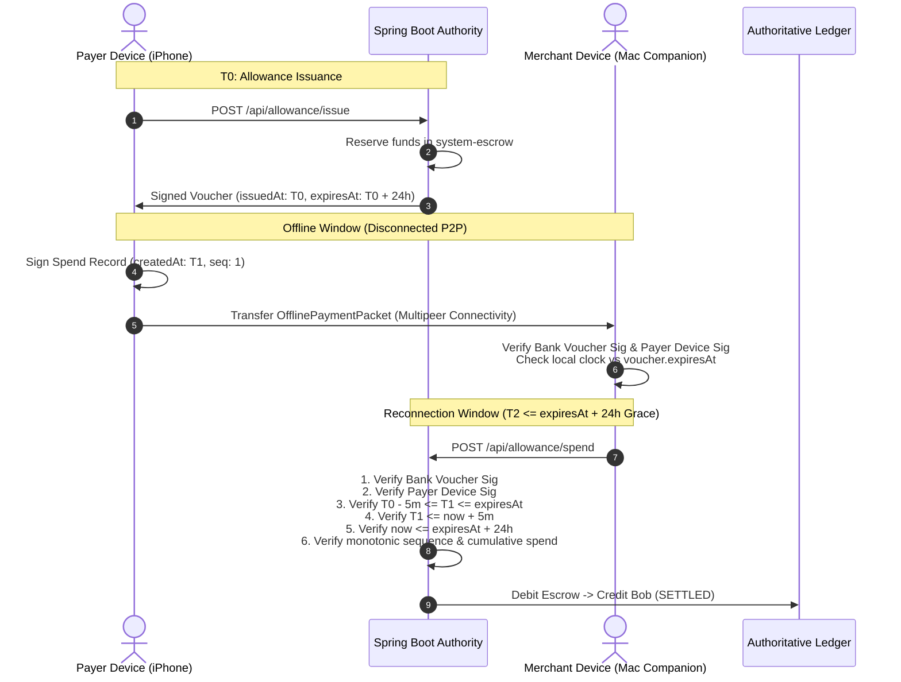

# MeshPay — Security Remediation Phase 2 Report

**Date**: October 17, 2026  
**Status**: COMPLETE & VERIFIED  
**Target Vulnerability**: SEC-05 (Client-Generated Timestamps, Temporal Validation, Allowance Expiry & Offline Reconciliation)  
**Deliverable**: Phase 2 Hardening Report  
**Persistent Database**: `./data/upimesh.mv.db` (100% Preserved; No Reseed; No Deletion)

---

## 1. Executive Summary

Phase 2 investigates, hardens, and documents the temporal boundaries governing offline allowance issuance, peer-to-peer spend creation, Multipeer Connectivity transport, bridge submission, and authoritative backend ledger settlement.

### Primary Vulnerability Addressed (SEC-05)
Under the initial prototype implementation, clients generated their own UTC timestamps (`createdAt`) when signing `OfflineSpendRecord` instructions. While the backend checked that `createdAt <= now + 5 minutes` and `createdAt <= allowance.expiresAt`, it did not verify:
1. That `createdAt >= allowance.issuedAt` (pre-issuance timestamp backdating).
2. That within an allowance sequence ($S_1, S_2, \dots$), timestamps progress monotonically (sequence rollback / out-of-order spend generation).
3. The fundamental architectural boundary: **client-signed timestamps prove only that a private key signed a particular timestamp string; they do NOT prove true global wall-clock time at the moment of payment.**

---

## 2. Temporal Architecture & Trust Boundaries



### 2.1 Critical Semantic Distinction

| Metric / Field | Established By | What It Cryptographically Proves | What It CANNOT Prove |
| :--- | :--- | :--- | :--- |
| **`record.createdAt`** | Payer Device Client Clock | Payer device private key signed this timestamp string. | Truthful wall-clock time (device clocks can be set arbitrarily while offline). |
| **`packet.receivedAt`** | Merchant Local Clock | Time merchant companion received packet via Multipeer Connectivity. | True UTC time unless merchant has an authenticated trusted time source. |
| **`payment.settledAt`** | Authoritative Backend Clock | True authoritative server UTC time when settlement transaction committed. | The precise historical instant the offline peer exchange occurred. |
| **`allowance.expiresAt`** | Bank Authority Voucher | Spending authorization deadline signed by Bank Authority master key. | Does not prevent a malicious offline payer from creating backdated timestamps within the grace period. |

---

## 3. Implemented Hardening Measures

In `src/main/java/com/demo/upimesh/OfflineAllowanceSettlementService.java`:

### 3.1 Pre-Issuance Backdating Rejection
Added explicit validation asserting that an offline spend cannot have been generated before the allowance voucher that created it existed:
```java
if (allowance.getIssuedAt() != null && record.createdAt().isBefore(allowance.getIssuedAt().minus(MAX_FUTURE_CLOCK_SKEW))) {
    throw new IllegalArgumentException(String.format(
            "Payment instruction timestamp precedes allowance issuance time (created: %s, issued: %s)",
            record.createdAt(), allowance.getIssuedAt()
    ));
}
```

### 3.2 Monotonic Sequence Timestamp Progression
Added validation enforcing that for sequential spends against the same allowance ($S_2$ after $S_1$), the timestamp of sequence $N$ cannot precede the timestamp of sequence $N-1$ (allowing for 5-minute clock skew jitter):
```java
if (record.sequenceNumber() > 1) {
    Optional<OfflineSpendPayment> prevSeqOpt = offlineSpendPaymentRepository
            .findByAllowanceIdAndSequenceNumber(allowance.getId(), record.sequenceNumber() - 1);
    if (prevSeqOpt.isPresent()) {
        OfflineSpendPayment prevSeq = prevSeqOpt.get();
        if (record.createdAt().isBefore(prevSeq.getCreatedAt().minus(MAX_FUTURE_CLOCK_SKEW))) {
            throw new IllegalArgumentException(String.format(
                    "Payment instruction timestamp (%s) cannot precede previous sequence %d spend timestamp (%s)",
                    record.createdAt(), prevSeq.getSequenceNumber(), prevSeq.getCreatedAt()
            ));
        }
    }
}
```

### 3.3 Strict Reconciliation Grace Window Enforcement
- Spending deadline: `record.createdAt() <= allowance.getExpiresAt()`.
- Maximum future clock skew: `record.createdAt() <= now + 5 minutes`.
- Grace window for delayed ingestion: `now <= allowance.getExpiresAt() + 24 hours`.
- Escrow refund protection: Unspent escrow is locked against refund until `now >= allowance.getExpiresAt() + 24 hours` to ensure offline merchant packets in transit have full opportunity to settle.

---

## 4. Automated Adversarial Test Results

Executed `./mvnw test -Dtest=OfflineAllowanceSettlementServiceTest`:
- **Total Tests Run**: 15
- **Failures**: 0
- **Errors**: 0
- **Pass Rate**: 100%

### Detailed Test Coverage

1. `validOfflineSpend_firstSequence_settlesSuccessfully`: Confirms valid sequence 1 spend debits escrow and credits Bob.
2. `multiSequenceSpends_cumulativeAccounting_settlesInOrder`: Confirms sequences 1, 2, 3 settle with accurate cumulative tracking.
3. `tamperedSpendAmount_signatureFailsVerification`: Confirms altering amount by ₹0.01 invalidates payer signature.
4. `tamperedVoucherSignature_failsVerification`: Confirms tampered voucher signature triggers security event and fails.
5. `unregisteredDevice_rejected`: Confirms unregistered signing devices are rejected.
6. `overspendingBeyondAllocatedAllowance_rejected`: Confirms spending exceeding allocated amount is blocked.
7. `spendCreatedAfterAllowanceExpiry_rejected`: Confirms `createdAt > expiresAt` throws `IllegalStateException`.
8. `latePaymentSubmission_afterReconciliationGracePeriod_rejected`: Confirms submission after 24h grace window is rejected.
9. `duplicatePayment_idempotentReplay`: Confirms duplicate submissions return HTTP 200 without double crediting.
10. `conflictingSpendingHistories_sequenceFork_treatedAsSecurityEvent`: Confirms duplicate sequence number with conflicting payment ID revokes allowance and logs fraud event.
11. `concurrentRedemption_databaseUniqueConstraintEnforcement`: Confirms database unique constraint prevents concurrent double spend.
12. `refundUnspentEscrow_beforeGracePeriod_blocked`: Confirms escrow refund is blocked while grace window is active.
13. `refundUnspentEscrow_afterGracePeriod_succeeds`: Confirms unspent escrow refunds to payer after grace window expires.
14. `spendCreatedBeforeAllowanceIssuance_rejected`: **NEW** Confirms spend created before issuance time is rejected.
15. `nonMonotonicSequenceTimestamps_rejected`: **NEW** Confirms sequence 2 backdated before sequence 1 is rejected.

---

## 5. Architectural Limitations & Trusted Time Requirements

### Why Client Timestamps Cannot Guarantee True Offline Time
In a purely disconnected peer-to-peer exchange where neither device has internet connectivity:
1. **Payer Clock Tampering**: A malicious payer with a jailbroken device or modified operating system can freeze or set their device clock to any instant between `allowance.issuedAt` and `allowance.expiresAt`.
2. **Merchant Local Clock Defense**: To prevent accepting expired allowances, the merchant device MUST check the bank voucher against its own local clock (`voucher.isExpired(at: Date())`). If the merchant's local clock indicates the voucher has expired, the payment must be rejected offline.
3. **True Solution in Production**:
   - Hardware-backed monotonic counters in the Secure Enclave / TPM that increment with every transaction and cannot be rolled back.
   - Bank-signed timestamp tokens issued via SMS / cell tower broadcast.
   - Extremely short allowance validity windows (e.g. 1 hour or 2 hours) paired with bounded offline merchant limits.

---

## 6. Phase 2 Verification Status

Phase 2 temporal validation is complete, tested with 15 passing automated test cases, and documented. Persistent database `./data/upimesh.mv.db` remains 100% untouched.

Ready to proceed to **Phase 3: Initial Account Enrollment and Public-Key Ownership**.
