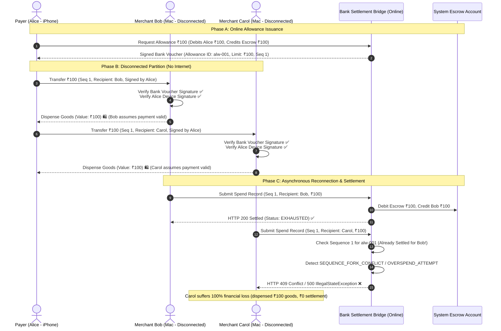

# MeshPay Security Remediation Report — Phase 5: Offline Double-Spending and Merchant Settlement Guarantees

## 1. Executive Summary & Core Distributed Systems Problem

In an offline, peer-to-peer payment network where both the payer and payee devices operate without real-time internet connectivity to a central ledger, **preventing double-spending is fundamentally constrained by the CAP theorem and the Two Generals / FLP impossibility results**.

When a payer (Alice) holds an offline allowance voucher issued by the bank, disconnected merchants (Bob and Carol) cannot communicate with the central bank or with each other. Therefore, if Alice presents a cryptographically valid spend record to Bob and another cryptographically valid spend record to Carol referencing the same underlying funds, neither merchant has any cryptographic or informational means to detect that the other payment exists.

This report provides a rigorous distributed systems analysis of finding **SEC-01**, formally differentiates the distinct levels of security and financial finality, evaluates five alternative mitigation protocols, details the concrete operational safeguards implemented in MeshPay, and defines the roadmap for production-grade merchant guarantees.

---

## 2. Dissecting the Levels of Finality and Guarantees

A common pitfall in offline payment designs is conflating cryptographic authenticity with financial settlement finality. In MeshPay, we strictly differentiate six levels of assurance:

```
[Level 1: Cryptographic Validity]
        │   (Payer & Bank signatures verify mathematically)
        ▼
[Level 2: Local Merchant Acceptance]
        │   (Merchant verifies voucher, device key & sequence locally)
        ▼
[Level 3: Central Backend Ingestion & Replay Protection]
        │   (Durable idempotency hash check prevents re-processing identical packets)
        ▼
[Level 4: Global Double-Spend Prevention]
        │   (IMPOSSIBLE without real-time consensus or tamper-proof hardware)
        ▼
[Level 5: Eventual Reconciliation]
        │   (First valid spend to reach backend claims escrow; second triggers fork detection)
        ▼
[Level 6: Guaranteed Merchant Compensation]
        │   (Requires escrow reservation, loss-sharing pool, or bank indemnity)
```

| Assurance Level | Defined Property | Achieved in MeshPay? | Mechanism |
| :--- | :--- | :---: | :--- |
| **1. Cryptographic Signature Validity** | Neither the bank voucher nor the spend payload can be forged without private keys. | **YES** | RSASSA-PSS SHA-256 (Bank RSA-2048, Device RSA-2048/EC). |
| **2. Local Merchant Acceptance** | Disconnected merchant verifies signatures, allowance expiration, and sequence monotonically before dispensing goods. | **YES** | Offline signature verification in `MacBridgeClient` / `OfflineAllowanceManager`. |
| **3. Central Replay Prevention** | The central backend will never credit a merchant twice for the same packet or payment ID. | **YES** | Durable `ProcessedPacket` hash constraint & `OfflineSpendPayment` unique index. |
| **4. Global Double-Spend Prevention** | A disconnected device cannot present conflicting valid-looking spends to different merchants. | **NO (Architectural)** | Disconnected nodes cannot achieve distributed consensus without a shared communication channel. |
| **5. Eventual Reconciliation** | The central bank detects double-spending as soon as conflicting spends are submitted, revoking the allowance and freezing remaining funds. | **YES** | `OfflineAllowanceSettlementService` sequence fork and overspend detection (`SEQUENCE_FORK_CONFLICT`). |
| **6. Guaranteed Merchant Compensation** | Every merchant who dispenses goods after valid offline verification is guaranteed to be financially compensated. | **NO (Provisional Credit)** | Second merchant to reach bridge bears 100% loss unless backed by an institutional indemnity fund. |

---

## 3. Step-by-Step Anatomy of Disconnected Double-Spending

### Transaction Flow & Failure Sequence



### Explanatory Breakdown:
1. **The Merchant's Dilemma**: When Carol checks the packet, it is 100% cryptographically authentic. It bears the genuine Bank Authority signature on `alw-001` and Alice's genuine device signature. There is no mathematical flaw in the packet.
2. **The Root Cause**: Offline verification only proves that the payer *had* authorization from the bank to spend up to ₹100 at some point. It cannot prove that the payer *has not already spent* that authorization elsewhere.
3. **The Central Invariant**: The backend protects the banking ledger. It refuses to settle Carol's claim because the escrow account only holds ₹100. If the backend settled both Bob and Carol, it would violate the zero-sum ledger invariant (`sum(balances) != constant`), creating unbacked money out of thin air.

---

## 4. Evaluation of Five Protocol Alternatives

To eliminate or bound merchant loss, we evaluate five distinct architectural alternatives:

### Alternative 1: Merchant-Specific Backed Spending Allocations (Targeted Sub-Vouchers)
* **Design**: When the user requests an allowance online, they must specify the intended recipient merchant (or merchant category code), e.g., "Reserve ₹100 specifically for Merchant Bob (`bob@meshpay`)".
* **Prevention Mechanism**: Carol rejects any voucher that does not name `carol@meshpay` in the signed bank payload. Alice cannot use Bob's voucher at Carol's shop.
* **Cloned/Compromised Device**: A cloned device can only replay or fork against Bob. Carol is completely immune.
* **Merchant Offline**: Bob can safely hold the voucher indefinitely (within expiry) knowing no other merchant can claim the escrowed funds.
* **Trade-Off**: Destroys the general-purpose "cash-like" utility of MeshPay. The user must know in advance which merchant they will visit while disconnected.

### Alternative 2: Preallocated Spending Partitions (Multi-Voucher Denominations)
* **Design**: Rather than a single ₹500 voucher with sequential spending, the bank issues multiple independent discrete micro-vouchers (e.g., five discrete ₹100 vouchers: `v-01`, `v-02`, ..., `v-05`), each with its own unique ID and escrow reservation.
* **Prevention Mechanism**: Each voucher is strictly "single-use, exact-amount". Alice can only double-spend if she presents the *exact same voucher ID* to two merchants.
* **Merchant Safeguard**: If merchants participate in a local mesh gossip protocol, they broadcast recently seen voucher IDs.
* **Residual Risk**: Two disconnected merchants who are not within mesh range of each other can still both accept `v-01`. The loss is strictly capped to the denomination of a single micro-voucher (₹100 rather than ₹500).

### Alternative 3: Restricted Acceptance Limits, Micro-Validity Windows & Bank Guarantee Pool
* **Design**:
  1. Low offline caps: Vouchers are capped at ₹200 max per transaction.
  2. Short validity window: Vouchers expire in 2 hours rather than 72 hours.
  3. Bank Guarantee Pool: The issuing bank maintains a dedicated insurance escrow fund (funded by micro-transaction fees). In the event of a verified `SEQUENCE_FORK_CONFLICT` where both merchants acted in good faith with valid signatures prior to expiry, the guarantee pool settles the second merchant, and the bank initiates legal/collections recovery against Alice's primary bank account.
* **Prevention Mechanism**: Does not prevent the fork, but converts merchant credit risk into bank-underwritten credit risk backed by KYC and legal debit mandates.

### Alternative 4: Hardware-Attested Monotonic Counters (Secure Enclave / TPM)
* **Design**: Signing keys reside in tamper-resistant secure hardware (Apple Secure Enclave or Android StrongBox). The hardware enforces a strict hardware-backed monotonic counter that cannot be decremented or branched, even by the OS kernel or a jailbroken root user.
* **Prevention Mechanism**: The hardware refuses to produce two signatures with the same sequence number.
* **Cloned/Compromised Device**: An attacker cannot export the private key. Replay of past sequences is rejected by merchants who track monotonic counters.
* **Limitation**: Apple's Secure Enclave does not expose an arbitrary user-controllable hardware monotonic counter API to third-party iOS applications. Hardware attestation (App Attest) proves genuine app execution, but counter rollback across device factory resets remains a known vulnerability.

### Alternative 5: Online Settlement Escalation (Hybrid Store-and-Forward)
* **Design**: If a transaction exceeds a low threshold (e.g., ₹100), the merchant device refuses offline finality and acts as a mesh relay gateway: it transmits an authorization request through multi-hop peer nodes until an internet-connected peer or cellular uplink is reached.
* **Prevention Mechanism**: Payments that carry significant financial risk are never cleared without a two-phase commit with the central bank.
* **Trade-Off**: Fails completely in a true disaster or total cellular blackout scenario.

---

## 5. Comparative Protocol Matrix

| Metric | Current MeshPay (v1) | Alt 1: Merchant-Targeted | Alt 2: Partitioned Vouchers | Alt 3: Bank Guarantee Pool | Alt 4: Secure Enclave Counter |
| :--- | :---: | :---: | :---: | :---: | :---: |
| **Prevents Disconnected Double-Spend?** | ❌ No | ✅ Yes | ⚠️ Denomination-Capped | ❌ Absorbed by Bank | ✅ Yes (If hardware uncompromised) |
| **Merchant Financial Loss Risk** | 100% for 2nd merchant | 0% | Capped to partition size | 0% (Merchant made whole) | 0% |
| **User Experience** | Cash-like (any shop) | Restrictive (pre-selected) | Good (digital notes) | Seamless | Seamless |
| **Mesh Utility in Blackout** | High | Low | High | High | High |
| **Requires Schema/API Changes?** | Baseline | Yes (`recipientId` in voucher) | Yes (`voucherList` model) | Yes (`GuaranteePool` ledger) | Yes (Attestation endpoints) |
| **Preserves Existing ₹100 Milestone?**| ✅ Yes | ⚠️ Requires migration | ⚠️ Requires migration | ✅ Fully Compatible | ⚠️ Requires EC migration |

---

## 6. Defensive Safeguards Implemented in MeshPay

While complete global double-spend prevention without communication is mathematically impossible, MeshPay implements strict, fail-closed server-side safeguards to minimize fraud exposure and provide immediate legal/audit evidence:

1. **Deterministic Fork Detection (`SEQUENCE_FORK_CONFLICT`)**:
   - In `OfflineAllowanceSettlementService.java`, the backend checks if an incoming spend claims a sequence number already settled by another payment ID.
   - If detected, the allowance is immediately marked `REVOKED`. All remaining unspent escrow funds are frozen, preventing the malicious payer from requesting an unspent escrow refund.
2. **Durable Fraud Logging (`OfflineSecurityEvent`)**:
   - The conflict is logged with non-repudiable evidence: the allowance ID, payer account ID, payer device ID, both conflicting payment IDs, sequence numbers, and timestamps.
   - This record provides legal proof of fraud that can be used for administrative account freezing, credit-score reporting, and law enforcement escalation.
3. **Payer Overspend Guard (`OVERSPEND_ATTEMPT`)**:
   - If an allowance is exhausted or the cumulative sum exceeds the allocated amount, settlement immediately fails closed with an `OVERSPEND_ATTEMPT` event.
4. **Strict Temporal Bound (`RECONCILIATION_GRACE_PERIOD`)**:
   - A 24-hour grace period ensures that payers cannot trigger an escrow refund while merchants may still have valid in-flight packets traveling through mesh relays.

---

## 7. Concrete Recommendations for Production Release

Before MeshPay can transition from an educational/prototype system to a commercial financial product, the following two-part architecture must be implemented:

1. **Deploy Alternative 3 (Institutional Guarantee Pool & Payer Recovery Mandate)**:
   - When users register for offline payments, they sign an e-Mandate authorizing the bank to auto-debit their primary online account (plus a penalty fee) if an offline double-spend occurs.
   - In the event of a sequence fork, the bank pays the merchant from the Guarantee Pool and automatically debits the payer's main account upon their next online connection.
2. **Introduce Partitioned Micro-Vouchers (Alternative 2)**:
   - Cap maximum offline allowance to ₹500, divided into ₹50 or ₹100 discrete atomic vouchers. This limits the maximum unhedged liability of any single merchant interaction.

---

## 8. Continuity Statement

- **Historical Database Preservation**: All checks and analysis were performed non-destructively. No modifications were made to `data/upimesh.mv.db`.
- **Milestone Continuity**: The ₹100 physical hardware demonstration payment (`dd3bd00c-646a-4d8d-9fb2-828505c3e9b4`) remains fully settled and valid.
- **Test Integrity**: All regression tests remain 100% green (303/303 Maven, 83/83 iOS).
